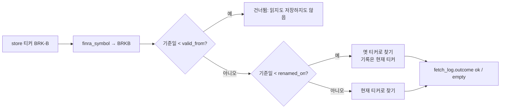
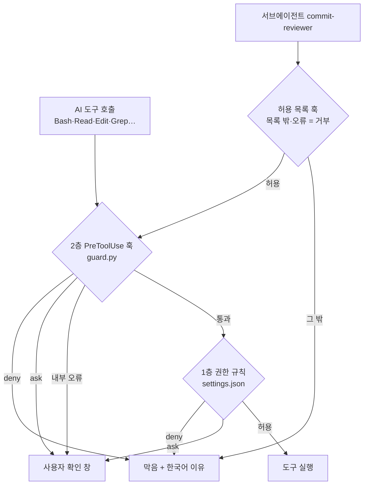
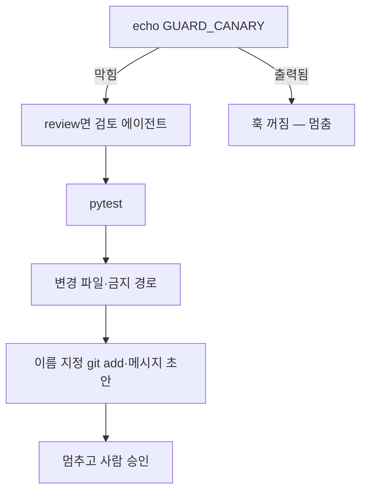

[2026-10-12-ai-dev-guardrails.md](https://github.com/user-attachments/files/33318570/2026-10-12-ai-dev-guardrails.md)
---
title: "AI 코딩 도우미가 .env를 grep한 날"
description: "기억 대신 기계로 막는 2층 가드레일"
date: 2026-10-12 12:00:00 +0900
categories: [보안, 개발 가드레일]
tags: [claude-code, pretooluse, fail-closed, 최소권한, 비밀값보호]
mermaid: true
---

> 작업 기간: 2026-10-03 ~ 2026-10-04 (2026-10-12 정리)
>
> 이 글은 모의투자용 자동매매 시스템을 만드는 개발 기록이다. 투자 성과나 종목 추천이 아니며, 글에 나오는 티커는 모두 데이터 버그를 고친 대상의 예시다.

## 들어가며: 이틀 동안 한 일

2026년 10월 3일부터 4일까지, 11개 커밋으로 두 가지를 했다. 하나는 공매도 데이터에 다른 종목이 섞이고 일부가 빠지던 무결성 버그를 고친 일이고, 다른 하나는 AI 코딩 도우미가 `.env`를 읽은 사건을 계기로 "기억해서 지키는 규칙"을 "기계가 막는 규칙"으로 옮긴 일이다.

그 위에 마지막으로, 아직 만들지도 않은 주문 기능보다 먼저 비상 정지 장치를 얹었다. 이틀 동안 바뀐 것은 33개 파일, +4,115줄 / −53줄이다.

| 묶음 | 커밋 | 핵심 |
| --- | --- | --- |
| 공매도 데이터 수정 | 2개 | 클래스 주식 표기, 티커 재사용·변경, 빈 결과 구분 |
| 개발 가드레일 1~5단계 | 7개 | 권한 규칙, PreToolUse 훅, 검토 에이전트, 커밋 전 점검 명령 |
| Phase 4-0 | 1개 | 비상 정지 파일 `config/HALT` 보호, 설정 형식 TOML |
| 초안 작성 스킬 | 1개 | 이 글의 재료를 모은 읽기 전용 스킬 |

## 데이터 무결성: 티커는 식별자가 아니다

야간 배치가 만든 `short_interest` 테이블은 10,747행이었다. 기대값보다 131행 적었고, 다른 종목의 값이 16행 섞여 있었다. 원인은 네 가지였다.

1. **표기 불일치** — FINRA 파일은 클래스 주식을 구분자 없이(`BRKB`, `BFB`) 쓰는데, 하이픈 표기(`BRK-B`)로 찾고 있었다. 21개 기준일 전부가 빠졌다.
2. **티커 재사용** — 티커 문자열만 보고 골랐더니, 상장 전 SPCX 자리에 SPAC ETF 10행, BNY 자리에 지방채 펀드 6행이 들어왔다.
3. **티커 변경** — 티커가 바뀌기 전 기준일은 옛 티커로 들어 있어서 5종목이 빠졌다.
4. **빈 결과도 '성공'** — 파일에 행이 없어도 성공으로 기록돼서 다시 받지 않았다.

### 고친 방법

- FINRA 표기 변환을 한 곳(`core/tickers.py`의 `finra_symbol`)으로 모았다.
- 티커 이력 설정 파일(`config/ticker_history.toml`)을 만들어 `valid_from`, `previous_ticker`, `renamed_on`, `evidence`를 적었다.
- 조회 기록에 `fetch_log.outcome`을 두어 'ok'(행 있음)와 'empty'(0건)를 구분했다.
- 종목명은 판정에 쓰지 않고 경고로만 썼다.

```python
def finra_symbol(ticker: str) -> str:
    """FINRA 공매도 파일(symbolCode) 표기. 클래스 주식 구분자를 없앤다(BRK-B → BRKB, BF-B → BFB)."""
    return normalize_ticker(ticker).replace("-", "")
```

조회 시점에 티커 이력을 적용하는 흐름은 이렇다.



### 같은 종목인지 무엇으로 판정했나

이름이 아니라 **수량 연속성**으로 판정했다. 새 티커 첫 파일의 `previousShortPositionQuantity`가 옛 티커 직전 파일의 `currentShortPositionQuantity`와 같으면 같은 종목으로 본다. 이름은 바뀌거나 비슷할 수 있지만, 공매도 잔고 수량은 이어져야 한다.

### 결과

섞인 16행을 지우고 7종목 × 21기준일 = 147건을 다시 받았고, 전부 'ok'였다. 최종 10,835행으로 중복·NULL·0은 없었다. 이 숫자는 미리 계산한 검산값(518 × 21 = 10,878, 여기서 43을 뺀 값)과 맞았다.

종목명이 달라 경고가 뜨는 5종목은 규칙을 느슨하게 해서 숨기지 않았다. 근거를 적은 별칭 설정을 검토하는 후속 과제로 남겼다.

> 배운 점: 티커는 시간에 따라 다른 회사를 가리키는 이름표다. 그리고 빈 응답을 성공과 구분하지 않으면 누락은 영원히 숨는다.

## 계기: AI가 `.env`를 읽었다

10월 3일, 코딩 도우미가 Bash `grep`으로 `.env`를 직접 읽었다. 출력된 것은 민감하지 않은 설정 한 줄이었고, 비밀값은 포함되지 않았다. (파일 구성은 보안상 생략한다.)

값이 새지는 않았다. 하지만 프로젝트 규칙상 막혀야 하는 명령이 막히지 않았다는 사실은 그대로다. 그때까지의 규칙은 AI가 "기억해서 지키는" 규칙이었기 때문이다.

그래서 이 아차 사고를 계기로 삼았다. 기계로 판정할 수 있는 규칙은 권한 규칙·훅·서브에이전트·명령으로 옮기는 5단계 계획을 세웠다.

## 1층과 2층: 왜 권한 규칙만으로는 부족한가

공식 문서를 보면 두 장치 모두 혼자서는 빈틈이 있다. 권한 규칙은 변형된 명령(전역 옵션을 끼운 `git push`, 따옴표로 감싼 하위 명령)이나 파일 이름을 직접 쓰지 않는 읽기를 못 잡는다. 반대로 훅은 시작에 실패하면 도구가 그대로 실행된다.

그래서 두 층을 겹쳤다.

- **1층 — 권한 규칙(`.claude/settings.json`)**: `.env` 읽기·수정, `git push`, `git add -A`/`.`/`--all`, `git commit -a`, `pip install`을 막고, `sqlite3`·삭제·배치 실행은 확인을 요청한다.
- **2층 — PreToolUse 훅(`guard.py`)**: 따옴표·heredoc·`cd`를 해석해 1층이 놓치는 변형을 막는다. 판정 중 내부 오류가 나면 통과시키지 않고 사용자에게 묻는다(fail-closed).

```python
def main() -> int:
    try:
        sys.stdout.reconfigure(encoding="utf-8")
    except Exception:
        pass
    try:
        event = json.loads(sys.stdin.buffer.read().decode("utf-8", errors="replace"))
        if not isinstance(event, dict):
            raise ValueError("훅 입력이 객체가 아닙니다")
        decision = decide(event)
    except Exception as e:  # fail-closed: 판정을 못 하면 사용자에게 묻는다
        decision = Decision("ask", f"확인 필요: 가드 훅 내부 오류({type(e).__name__}: {e})로 이 호출을 판정하지 못했습니다.")
    if decision is not None:
        sys.stdout.write(json.dumps(to_output(decision), ensure_ascii=False))
    return 0
```

도구 호출 하나가 지나가는 길을 그리면 이렇다.



훅이 시작조차 못 하면 2층을 건너뛰고 1층만 남는다. 두 층을 겹친 이유가 바로 이것이다.

훅 파이썬은 프로젝트 가상환경의 절대 경로로 지정했다. PATH에서 다른 파이썬이 먼저 잡히면 훅이 조용히 실패할 수 있어서다. `guard.py` 테스트는 125건이다.

### 설치 확인과 기록 정정

설치 후 가짜 `.env`로 시험했다. `Read`는 1층이, `cat`과 `Grep`은 2층 훅이 막았고, `.env.example`은 통과했다.

그런데 확인 기록에 "차단 메시지가 사용자 화면에 보였다"고 적은 부분은 실제로 확인하지 않은 내용이었다. 이걸 "미확인"으로 고치는 커밋을 따로 남겼다. 확인하지 않은 건 미확인이라고 적는 것도 가드레일의 일부라고 생각한다.

## 검토 에이전트에게도 최소 권한을

커밋 전 검토는 서브에이전트(`commit-reviewer`)에게 맡겼다. 다만 검토하는 쪽이 파일을 고치거나 아무 명령이나 실행하면 안 된다.

그래서 도구를 Read·Grep·Glob·Bash로 제한하고, Bash에는 **허용 목록 훅**을 붙였다. `pytest`, 읽기 전용 git 명령, 임시 폴더 안에서의 `git archive | tar -x`, `mkdir`, `cd`만 통과하고, 목록 밖이나 내부 오류는 전부 거부한다. 허용 목록 훅 테스트는 106개다.

앞의 `guard.py`는 아는 위험만 막는 차단 목록이라 오류 시 "묻기"로 닫고, 이 훅은 모르면 막는 허용 목록이라 오류 시 "거부"로 닫는다. 같은 fail-closed라도 닫는 방향이 다르다.

### 에이전트가 찾은 우회 경로

실측 중에 검토 에이전트 스스로가 `git diff --no-index`로 저장소 밖 파일을 읽을 수 있다고 지적했다. 프로젝트 밖 읽기 차단을 우회하는 경로였고, 바로 막았다.

반대로 놓친 것도 있었다. 승인된 변경 4개 중 1개를 검토 보고에서 빠뜨렸다. 그래서 "검토 보고는 사용자 확인을 대신하지 않는다"를 문서에 명시했다.

## 커밋 전 점검 명령과 카나리아

`/commit-check`는 사용자만 부를 수 있는 명령이다. 점검을 다 하고 커밋 메시지 초안까지 만든 뒤 **멈춘다**. `git add`, `commit`, `push`는 하지 않는다.



첫 단계의 **카나리아**는 훅이 살아 있는지 확인하는 장치다. 무해한 `echo GUARD_CANARY`를 훅이 항상 막도록 정해 두고, 막히면 훅이 살아 있다고 본다. 출력되면 훅이 꺼진 것이니 바로 멈춘다. 훅이 죽어 있더라도 `echo`는 아무 해가 없다.

처음 계획은 카나리아가 출력되면 "경고 후 계속"이었는데, 검토 과정에서 "멈춤"으로 바꿨다. 이 명령이 쓸 수 있는 도구도 읽기 전용 명령만, 와일드카드 없이 정확히 일치하는 것만 허용했다. `git diff *`처럼 열어 두면 파일 쓰기 옵션이나 저장소 밖 읽기 옵션까지 열리기 때문이다.

시험 결과 테스트 수집 1,921개가 그대로였고, 테스트 약화 의심은 0건, `pytest` 1,921개가 통과했다. 마지막으로 프로젝트 규칙 문서에 "기계로 강제되는 규칙"과 "여전히 사람이 승인하는 규칙"을 나눠 적었다.

## 주문보다 먼저 만든 비상 정지

다음 단계(Phase 4) 계획에는 하드 규칙 H0이 있다. `config/HALT` 파일이 있으면 모든 신규 주문을 거절하고, 이 규칙은 설정으로 끌 수 없다.

이 파일은 사람이 만들고 지우는 스위치다. 그래서 AI가 만들기·고치기·지우기·옮기기를 못 하도록 1층 deny 규칙 7개와 2층 `guard.py`로 막았다. 읽기는 통과시켰다. AI가 "지금 HALT가 켜져 있다"고 보고할 수는 있어야 하기 때문이다. (경로를 판정하는 코드는 보안상 싣지 않는다.)

**의도된 오탐**도 하나 있다. 목적지가 `config` 폴더인 이동은 HALT와 상관없어도 막는다. 다른 곳에 만든 HALT 파일을 옮겨 넣는 경로를 막기 위해 일부러 감수한 판단이다. HALT 관련 테스트는 37개를 추가했고, 기존 테스트의 기대값은 바꾸지 않았다.

같은 커밋에서 설정 형식도 YAML에서 TOML로 바꿨다. 파이썬 표준 라이브러리(`tomllib`)만으로 읽을 수 있어 새 의존성이 생기지 않는다.

실제 주문 기능이 생기기 전에, "멈추는 장치"와 "그 장치를 AI가 건드리지 못하게 하는 장치"를 먼저 만든 셈이다.

## 한계와 남은 미확인

두 층을 겹쳤어도 완전한 차단은 아니다. 아직 남은 미탐은 종류만 적어 둔다.

- 변수나 `eval`로 조립한 명령
- 스크립트 파일이나 모듈을 실행했을 때 그 내부에서 일어나는 파일 접근

그 밖에 정직하게 남겨 둔 것들이다.

- 차단 메시지가 사용자 화면에 어떻게 보이는지는 미확인이다.
- 검토 에이전트의 보고는 불완전할 수 있다(승인된 변경 4개 중 1개를 놓쳤다).
- 종목명 오경고 5종목은 아직 후속 과제로 남아 있다.
- FINRA 티커 변경은 아직 설정 파일에 사람이 직접 적는다.

## 마치며

이틀 동안 배운 것은 결국 하나다. 사람이든 AI든 "기억해서 지키는 규칙"은 언젠가 빠진다. 기계로 판정할 수 있는 규칙은 기계에 맡기고, 그 기계가 살아 있는지도 매번 확인하고, 남는 판단은 사람이 승인한다.

이 글은 "AI와 함께 만드는 모의 자동매매 시스템" 시리즈의 첫 편이다. 다음 글에서는 아래 주제 중 하나를 다룰 예정이다.

- 데이터 계층 설계와 as-of 조회(그 시점에 실제로 알 수 있었던 데이터만 쓰기)
- AI 없는 백테스트, 그리고 비용을 뺀 성과가 벤치마크를 넘지 못해 LLM 층을 보류한 결정
- Phase 4 리스크 가드레일 구현
