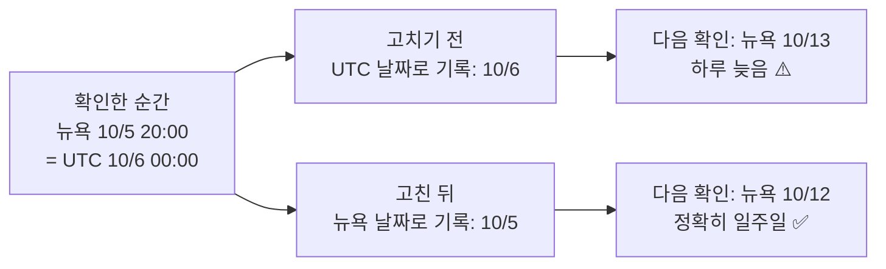
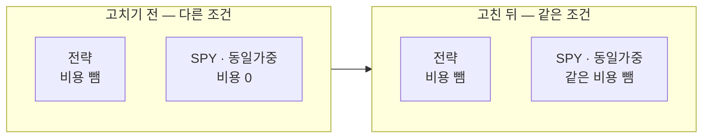
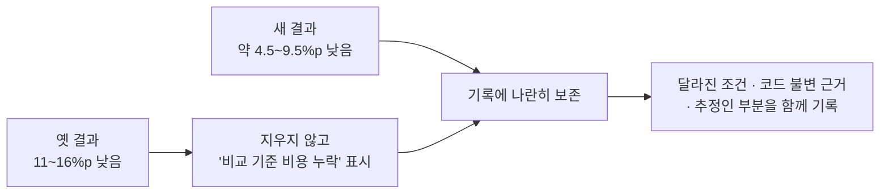

> 작업 기간: 2026-10-05 ~ 2026-10-07 (2026-10-13 정리)
>
> 이 글은 모의투자용 자동매매 시스템을 만드는 개발 기록이다. 투자 성과나 종목 추천이 아니며, 백테스트 수치는 측정 방법을 설명하기 위한 것이다.

## 들어가며

이번 주에는 측정 쪽에서 두 가지를 고쳤다. 하나는 날짜를 비교할 때 시간대가 섞인 버그이고, 다른 하나는 백테스트에서 전략과 비교 기준이 같은 조건이 아니었던 문제다. 두 번째는 고치고 나니 이전 결론의 크기가 꽤 달라졌다.

## 1. UTC 날짜와 뉴욕 날짜를 섞어 비교했다

야간 배치에는 일부 데이터를 "주 1회만 다시 확인"하는 규칙이 있다. 마지막 확인 기록과 오늘 날짜를 비교해서 일주일이 지났으면 다시 받는다.

문제는 비교하는 두 날짜의 기준이 달랐다는 점이다.

- 확인 기록의 시각은 **UTC**로 저장되고, 거기서 날짜를 뽑았다.
- "오늘"은 **뉴욕 날짜**였다.

뉴욕 저녁은 UTC로는 다음 날이다. 그래서 뉴욕 저녁에 남긴 확인 기록은 하루 늦게 찍힌 것처럼 보였고, 다음 확인이 하루씩 밀렸다.

예를 들어 뉴욕 시각 10월 5일 월요일 저녁 8시에 확인했다면 이렇게 된다.

고친 방법은 단순하다. 두 날짜를 모두 뉴욕 날짜로 바꿔서 비교하고, 그 판단을 함수 하나로 묶었다.

같은 원인으로 테스트 하나는 **한국 시각 0시~9시에 돌리면 실패**했다. 테스트가 "실행한 순간"을 기준으로 간격을 쟀기 때문이다. 저장된 기록의 뉴욕 날짜를 기준으로 재도록 바꿨다. 미국 동부 서머타임(EDT)과 표준시(EST), 서머타임이 끝나는 날의 경계 시각 테스트도 추가했다.

그리고 프로젝트 규칙 문서에 "뉴욕 날짜가 아니라 그냥 '오늘'을 쓰는 곳"을 목록으로 남겼다. 이번에 고치지 않은 곳까지 찾아서 적어 둔 것이다.

> 배운 점: 시간을 다룰 때는 저장 기준과 비교 기준을 하나로 맞춘다. 그리고 "언제 돌리느냐"에 따라 결과가 바뀌는 테스트는 그 자체가 버그 신호다.

## 2. 비교 기준에만 비용이 빠져 있었다

백테스트 보고서는 전략의 성과를 두 가지 비교 기준과 나란히 보여 준다. 시장 지수 ETF(SPY)를 그냥 들고 있는 경우와, 같은 종목 묶음을 똑같은 비중으로 사는 경우다.

그런데 전략에는 수수료와 환전 비용을 빼고, 비교 기준에는 비용을 0으로 두고 있었다. 같은 조건의 비교가 아니었다.

### 고친 방법

- 비교 기준에도 전략과 같은 비용을 적용한 행을 추가했다. 비용 0인 기존 행은 그대로 둔다.
- "주 1회 재조정·비용 0" 행을 하나 더 넣었다. 비용의 효과와 재조정 주기의 효과를 나눠서 읽기 위해서다.

| 비교 | 읽을 수 있는 것 |
| --- | --- |
| 같은 주기, 비용 0 ↔ 비용 적용 | 비용의 효과 |
| 매일 ↔ 주 1회, 둘 다 비용 0 | 재조정 주기의 효과 |

새 계산에는 손으로 계산한 기대값을 테스트로 붙였다.

### 결론이 바뀐 크기

| | 전략이 SPY보다 낮은 정도 (비용 적용, 뒤 기간) |
| --- | --- |
| 고치기 전 (SPY에 비용 없음) | 11 ~ 16%p |
| 고친 뒤 (같은 비용 적용) | 약 4.5 ~ 9.5%p |

다시 실행한 결과, 이전에는 "비용을 빼면 전략이 SPY보다 11~16%p 낮다"고 적었던 차이가 **약 4.5~9.5%p**로 줄었다. 전략이 여전히 SPY보다 낮다는 방향은 같지만, 크기는 절반 가까이 과장되어 있었다.

비용이 없는 조건에서는 뒤 기간에 전략이 SPY를 앞섰다. 하지만 앞 기간은 비용이 없어도 SPY와 비슷했다. 그래서 이것을 "종목을 고르는 실력"이라고 단정하지 않았다.

## 3. 틀린 기록을 어떻게 남겼나

결과를 고치는 것만큼 기록을 고치는 방식도 중요하다고 생각했다.

- **옛 숫자는 지우지 않았다.** "비교 기준 비용 누락"이라는 표시를 붙여서 그대로 남겼다. 무엇이 왜 바뀌었는지 나중에도 추적할 수 있게 하기 위해서다.
- **비교할 때 달라진 조건을 함께 적었다.** 데이터 갱신으로 마지막 날짜가 바뀌어서, 비용 0인 행도 조금 달라졌다.
- **코드가 바뀌지 않았다는 근거를 남겼다.** 옛 실행 이후 전략 코드가 바뀌지 않았다는 것을 커밋별로 확인해 적었다. 다만 실행 당시 작업 폴더 상태는 추정이라고 밝혔다.
- **지금 고치고 싶은 것을 참았다.** 매매 횟수(회전율)가 비용을 키운다는 가설은 이번 결과로 더 강해졌다. 하지만 이미 뒤 기간 결과를 본 상태에서 전략을 고치면, 그 기간에만 맞춘 전략이 된다. 그래서 지금 조정하지 않고 모의투자에서 확인한다는 원칙을 지켰다.

> 배운 점: 비교는 같은 조건에서 한다. 틀린 기록은 지우지 말고 정정 표시를 붙인다. 결과를 이미 본 데이터로는 전략을 고치지 않는다.

## 한계

- 백테스트 비교는 세금을 빼기 전 기준이다.
- 옛 실행 당시 작업 폴더 상태는 추정이다.

## 마치며

이번 주에 고친 것은 계산 몇 줄이다. 하지만 그 몇 줄 때문에 "전략이 크게 뒤처진다"는 결론이 "덜 뒤처지지만 여전히 실력이라고 말하기 어렵다"로 바뀌었다. 측정 도구를 의심하는 습관이 결론을 지키는 첫 번째 가드레일이라고 생각한다.
