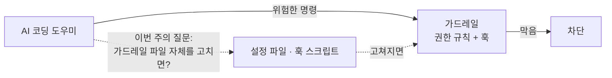
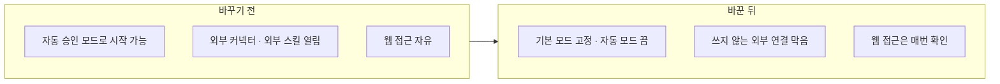
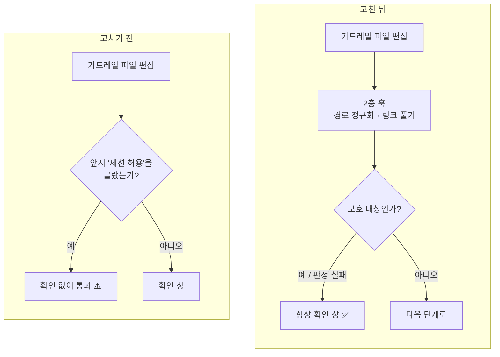
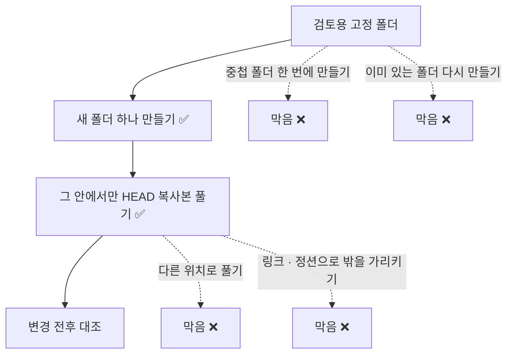

> 작업 기간: 2026-10-05 ~ 2026-10-08 (2026-10-13 정리)
>
> 이 글은 모의투자용 자동매매 시스템을 만드는 개발 기록이다. 투자 성과나 종목 추천이 아니다.

## 들어가며

[지난 글](/posts/ai-dev-guardrails/)에서 AI 코딩 도우미가 위험한 명령을 실행하지 못하게 권한 규칙(1층)과 PreToolUse 훅(2층)을 겹쳐 세웠다. 이번 주의 질문은 그다음 단계였다. **AI가 그 가드레일 파일 자체를 고치면 어떻게 되는가?**

규칙이 들어 있는 설정 파일과 훅 스크립트를 바꿀 수 있다면, 앞에서 만든 장치는 모두 의미가 없어진다.

그래서 이번 주에는 세 가지를 했다.

| 한 일 | 핵심 |
| --- | --- |
| 공격면 줄이기 | 시작 모드 고정, 쓰지 않는 외부 연결 끄기 |
| 자기 보호 | 문서와 실측으로 빈틈을 찾고, 가드레일 파일 편집에 확인 요청 |
| 검토 에이전트 작업 폴더 | 임시 폴더가 없는 세션 대비, 링크·정션 거부 |

## 1. 쓰지 않는 것은 끈다

먼저 AI 도우미가 할 수 있는 일의 범위 자체를 줄였다.

- **시작 모드 고정**: 모든 변경을 자동 승인하는 모드로 시작하지 않도록 기본 모드를 고정하고, 자동 모드는 꺼 두었다.
- **외부 연결 최소화**: 이 프로젝트에서 쓰지 않는 외부 커넥터, 외부 스킬, 문서·아티팩트 도구를 막았다.
- **웹 접근은 확인**: 웹 검색과 웹 페이지 읽기는 매번 사용자 확인을 거치게 했다.

설정을 바꾼 뒤 세션을 다시 시작해서 실제 동작을 확인했다. 확인할 만한 결과가 두 가지 나왔다.

1. 확인 요청 규칙은 미리 승인해 둔 도메인보다 우선했다. 승인 목록에 있는 사이트라도 확인 창이 떴다.
2. 도구를 끄는 설정은 도구를 "거절"하는 수준이 아니라 도구 목록에서 아예 없앴다.

보안에서 공격면을 줄이는 기본 원칙과 같다. 쓰지 않는 기능은 막는 규칙을 만드는 것보다 꺼 두는 편이 단단하다.

## 2. 내 가정을 실측으로 정정했다

처음에는 "파일 편집을 자동 승인하는 모드에서는 가드레일 파일이 확인 없이 고쳐진다"고 문제를 적어 두었다. 그런데 공식 문서를 다시 읽어 보니, 설정 폴더 쓰기는 **보호 경로**로 분류되어 그 모드에서도 확인 창이 뜬다고 되어 있었다. 출발점이 틀렸던 것이다.

그래서 기록부터 고쳤다. 그다음 문서만 믿지 않고 빈틈 후보를 세 가지로 좁혀 직접 시험했다.

| 후보 | 결과 |
| --- | --- |
| ① 확인 창에서 "이 세션 동안 허용"을 고른 뒤의 편집 | **실제 빈틈.** 그 뒤의 편집은 확인 없이 통과 |
| ② 쓰지 않는 권한 모드 | 쓰지 않으므로 기록만 남김 |
| ③ 스크립트 내부에서 일어나는 수정 | 기존 훅의 한계와 같은 종류 |

같은 시험에서 셸 명령으로 파일을 쓰거나 다른 곳의 파일을 복사해 넣는 경로는, 세션 허용을 고른 뒤에도 기본 보호에 걸렸다. "영구 허용"이 보호 경로를 뚫는지는 확인하지 못해 **미확인**으로 남겼다.

그리고 운영 규칙을 하나 더했다. 확인 창의 "세션 허용"과 "영구 허용"은 실측할 때 말고는 고르지 않는다.

## 3. 빈틈 ① 닫기

빈틈 ①은 사람이 확인 창에서 넓은 허용을 한 번 고르면 열리는 문제다. 그래서 1층 설정에 기대지 않고, 2층 훅이 직접 막게 했다.

- 저장소의 설정 폴더, MCP 설정 파일, 사용자 설정 파일을 고치는 편집 도구 호출에는 훅이 **항상 확인을 요청**한다. 세션 허용을 골랐더라도 마찬가지다.
- 경로는 정규화하고 링크를 푼 뒤에 판정한다. 다른 이름이나 링크로 같은 파일을 가리키는 경우를 잡기 위해서다.
- 경로 판정에 실패하면 통과시키지 않고 확인을 요청한다(fail-closed).
- "모든 훅 끄기" 설정은 명시적으로 꺼 두었다. 기본값에 기대지 않기 위해서다.

테스트는 35개를 추가했고, 실제 세션에서 다섯 가지 경우를 실측해 결과를 문서에 남겼다.

> 배운 점: 보호 장치도 보호 대상이다. 그리고 공식 문서를 근거로 삼되, 결론은 실측으로 낸다.

## 4. 검토 에이전트가 쓸 작업 폴더

[지난 글](/posts/ai-dev-guardrails/)의 커밋 전 검토 에이전트는 현재 커밋(HEAD)의 복사본을 임시 폴더에 풀어 변경 전후를 대조한다. 그런데 어떤 세션에서는 그 임시 폴더 경로가 주어지지 않아 복사본을 만들지 못했다. 그 주 중간의 한 커밋은 테스트 변경이 추가뿐이라 대조 없이 추정으로 진행했고, 그 사실을 커밋 기록에 그대로 적었다.

해결은 이렇게 했다.

- 검토용 **고정 폴더**를 하나 정하고, 그 아래에 새 폴더 하나만 만들 수 있게 했다. 중첩 폴더를 한 번에 만드는 옵션은 막았다.
- 압축 풀기와 폴더 이동은 그 새 폴더 안에서만 허용했다.
- 링크와 Windows 정션은 거부한다. 고정 폴더 밖을 가리키는 통로가 될 수 있기 때문이다.

허용 목록 훅 테스트를 29개, 가드 훅 테스트를 9개 추가했다. 실측에서는 복사본 대조가 성공했고, 막혀야 하는 경우 세 가지도 실제로 막히는 것을 확인했다. 이미 있는 폴더 다시 만들기, 중첩 폴더 한 번에 만들기, 다른 위치로 압축 풀기다.

다만 "검토할 때마다 새 폴더를 쓴다"는 것은 기계로 강제하지 못하고 절차로만 보장한다. 이 한계와 그렇게 정한 이유도 문서에 적어 두었다.

## 한계와 남은 미확인

- 확인 창의 "영구 허용"이 보호 경로를 뚫는지는 미확인이다.
- 스크립트 파일 내부에서 일어나는 수정은 훅이 보지 못한다(기존 한계와 같음).
- 검토용 폴더를 매번 새로 쓰는 것은 절차로만 보장한다.

## 마치며

지난주에는 "AI가 위험한 일을 못 하게" 막았다면, 이번 주에는 "그 막는 장치를 AI가 건드리지 못하게" 했다. 공격면을 줄이고, 문서를 근거로 가설을 세우고, 실측으로 빈틈을 확정한 뒤 닫는 순서였다.

다음 글에서는 같은 주에 만든 리스크 가드레일, 즉 매매 결정이 주문으로 넘어가기 전에 반드시 지나야 하는 검문소를 다룬다.
