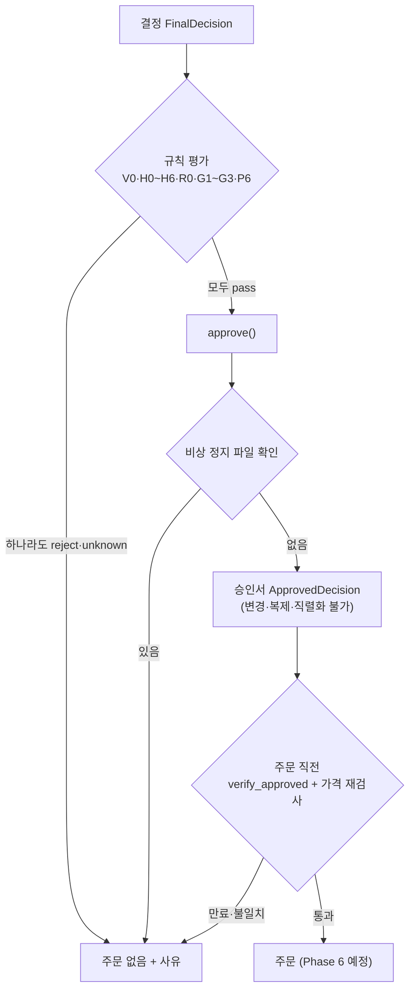
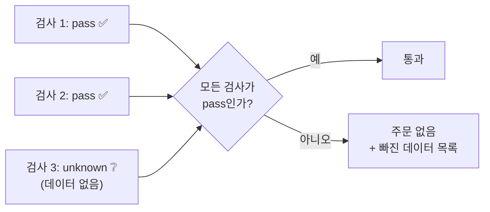
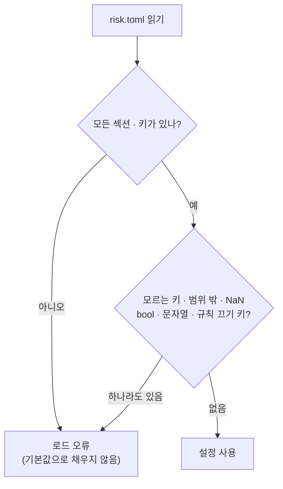
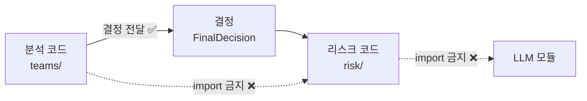

> 작업 기간: 2026-10-08 ~ 2026-10-11 (2026-10-13 정리)
>
> 이 글은 모의투자용 자동매매 시스템을 만드는 개발 기록이다. 투자 성과나 종목 추천이 아니며, 규칙의 실제 기준값은 다루지 않는다.

## 들어가며

이 시스템에서는 분석 결과가 "결정(FinalDecision)"으로 모인다. 이번 주에 만든 것은 그 결정이 주문으로 넘어가기 전에 반드시 지나야 하는 **검문소**, 리스크 가드레일이다.

아직 실제 주문 기능도, 백테스트 엔진 연결도 없다. 검문소를 먼저 완성하고 결과가 바뀌지 않는다는 것을 증명한 뒤에 연결한다는 순서다. 나흘 동안 계획 문서 3개와 구현 커밋 10여 개를 남겼고, 전체 테스트는 3,158개가 통과한다.

설계는 보안에서 쓰는 원칙 다섯 가지로 정리된다.



## 원칙 1. 모르면 통과가 아니라 '판단 불가'

규칙 검사의 결과는 통과(pass)와 거절(reject) 말고 하나가 더 있다. **판단 불가(unknown)**다. 필요한 데이터가 없으면 그 검사는 unknown이 되고, 결정 전체는 모든 검사가 pass일 때만 통과한다.

- 빠진 값을 0으로 채워 계산하지 않는다. `None`, `NaN`, bool, 문자열은 계산 전에 unknown 또는 거절로 처리한다.
- 보유 종목이나 미체결 주문을 모르면 매수는 거절된다.
- 반대로 현금이 0인 것은 "모르는" 상태가 아니라 정상 상태라서, 판단 불가가 아니라 "현금 없음"으로 거절한다. 음수만 unknown이다.



unknown이 하나라도 섞이면 나머지가 모두 pass여도 통과하지 못한다. "모르는 것"을 "괜찮은 것"으로 취급하지 않는다는 뜻이다.

## 원칙 2. 설정은 모든 키가 필수

리스크 설정 파일(`config/risk.toml`)은 **모든 섹션과 키가 필수**다. 키가 빠지면 기본값으로 채우지 않고 로드 오류를 낸다. 키 하나를 빠뜨렸을 때 가장 느슨한 값으로 조용히 돌아가는 일을 막기 위해서다.

다음 경우도 모두 로드 오류다.

- 모르는 키나 섹션, 범위를 벗어난 값, `NaN`과 무한대
- 숫자 자리에 들어온 bool이나 문자열
- 하드 규칙을 끄는 스위치처럼 생긴 키



bool을 따로 막은 데는 이유가 있다. 파이썬에서 `True`는 정수 1과 같게 취급되어서, 숫자 검사를 그대로 통과하던 빈틈이 있었다.

지금 저장소에 들어 있는 값은 모두 "효과 없음" 값이다. 기존 동작을 바꾸지 않는 값이라는 근거를 테스트로 묶어 두었고, 실제 값은 이후 단계에서 과거 데이터로 정한다.

## 원칙 3. 실수는 사람이 아니라 구조로 막는다

- **키워드 인자로만 생성**: 내부 데이터 타입은 위치 인자로 만들 수 없다. 필드 순서를 헷갈려 값이 뒤바뀌는 실수를 기계가 막는다.
- **단위 변환은 두 함수로만**: 비중은 %와 비율(0~1)을 오가는데, 변환은 함수 두 개로만 한다. `risk/` 안에서 `/ 100`이나 `* 100`을 직접 쓰면 테스트가 실패한다. 파이썬 문법 트리(AST)를 검사하는 테스트다.
- **가격 종류는 필수 인자**: 주식 수를 계산할 때 "수정주가인지 실제 가격인지"를 반드시 밝혀야 한다. 주식 분할 전 실제 가격이 1,200달러인 종목을 1만 달러어치 사면 8주인데, 10대 1 분할을 반영한 수정주가 120달러로 계산하면 83주가 된다. 정수 주를 수정주가로 계산하는 조합은 오류로 막았다.
- **모듈 경계**: 분석 코드(`teams/`)는 리스크 코드(`risk/`)를 import할 수 없고, 리스크 코드는 LLM 모듈을 불러오지 않는다. 둘 다 테스트로 고정했다. 검문소가 언어 모델의 판단에 기대지 않게 하기 위해서다.



## 원칙 4. 승인서는 위조도 변조도 못 하게

검문소를 통과한 결정은 **승인서(`ApprovedDecision`)**가 된다. 이 객체는 `approve()` 함수로만 만들 수 있고, 만든 뒤에는 바꿀 수 없다.

```python
class ApprovedDecision:
    """가드레일을 통과한 결정. approve()로만 만든다."""

    def __init_subclass__(cls, **kwargs):
        raise TypeError("ApprovedDecision은 하위 클래스를 만들 수 없습니다")

    def __init__(self, *args, **kwargs):
        raise TypeError("ApprovedDecision은 approve()로만 만든다")

    def __setattr__(self, name, value):
        raise TypeError("ApprovedDecision은 바꿀 수 없습니다")

    def __copy__(self):
        raise TypeError("ApprovedDecision은 복제할 수 없습니다")

    def __reduce__(self):
        raise TypeError("ApprovedDecision은 직렬화(pickle)할 수 없습니다 — to_log_dict()를 쓴다")

    @property
    def decision(self):
        return self._decision.model_copy(deep=True)  # 돌려받은 값을 고쳐도 원본은 그대로
```

(발췌. 삭제·깊은 복사 등을 막는 메서드는 생략했다.)

- dataclass를 쓰지 않았다. `dataclasses.replace()`가 생성자를 다시 불러 제한을 우회할 수 있기 때문이다.
- 승인서에는 유효 기간이 있다. 기준일 다음 거래일 하루만 유효하고, 날짜는 뉴욕 기준으로 판정한다.
- 현재 시각은 시간대가 있는 값만 받는다. 값을 비워 두면 "지금"이 조용히 쓰여, 테스트나 백테스트에 오늘 기준 승인이 섞일 수 있기 때문이다.
- 주문 직전에는 `verify_approved`가 내용을 다시 검사하고, 그 시점 가격으로 규칙을 다시 평가한다.

암호 서명(HMAC)은 일부러 쓰지 않았다. 이 객체는 한 프로세스 안에서만 쓰이고 프로세스 밖으로 보낼 수 없다. 같은 프로세스의 코드가 작정하고 우회하는 것까지 막는 **보안 경계가 아니라, 실수를 막는 장치**라고 범위를 정했다. 그 대신 주문 직전 재검사를 둔다. 우회 시도 25가지를 테스트로 넣어 모두 막히는지 확인했다.

## 원칙 5. 경계값은 고치기 전에 테스트로 먼저 보인다

정수 주식 수를 계산하다 부동소수점 문제를 만났다. 123.2달러로 1.1달러짜리를 사면 112주가 나오는데, 112 × 1.1은 `123.20000000000002`로 쓸 수 있는 금액을 아주 조금 넘는다. 현금보다 많이 사는 주문이 나올 수 있다는 뜻이다.

| 계산 | 주식 수 | 주식 수 × 가격 | 쓸 수 있는 금액 이하? |
| --- | --- | --- | --- |
| 고치기 전 | 112주 | 123.20000000000002달러 | ❌ 넘음 |
| 고친 뒤 | 111주 | 122.1달러 | ✅ |

고치는 순서는 이랬다.

1. 고치기 전 식이 금액을 넘는다는 것을 테스트로 먼저 재현한다.
2. 금액을 넘으면 한 주를 뺀다. 한 번만 빼는 보수적인 방식이다.
3. 고친 뒤 결과(111주)를 테스트로 고정한다.

매수 지정가 상한 계산도 같은 태도로 처리했다. 계산한 상한이 사후 검사를 통과하지 못하면 1센트씩 내려가며 맞는 값을 찾지 않고, "상한 없음"으로 거절한다(fail-closed).

## 리팩터링해도 결과가 같다는 증명

검문소를 기존 코드와 이어 붙이면서, 기존 결과가 바뀌지 않았다는 것을 테스트로 증명했다.

- **순위 계산 공용화**: 옛 식을 글자 그대로 복사한 기준 함수와 새 함수를 288가지 입력 조합에서 대조했고, 동점 후보 8개의 순서 500가지를 섞어도 결과가 같았다.
- **매수 후보 고르기**: 새 함수와 백테스트 엔진의 기존 반복문을 무작위 입력 300개에서 대조했고, 입력 순서를 720가지로 바꿔도 결과가 같았다.

이 기간에 기존 테스트의 기대값을 바꾼 경우는 손에 꼽고, 바꿀 때마다 "약화가 아니라 강화"인 이유를 커밋 메시지에 적었다.

## 한계

- 승인서가 만들어진 뒤 목표가나 이유 문장이 바뀐 것은 재검사로 잡지 못한다.
- 지정가 상한이 센트 경계에서 "상한 없음"이 되는 경우가 있다(재현됨).
- AST 검사는 최선 노력이라 우회나 오탐이 있을 수 있다.
- 프로세스 밖으로 넘기는 경우와, 비상 정지 파일 확인과 주문 사이의 시간 차는 아직 다루지 않았다.
- 업종 정보는 과거가 아니라 현재 기준이다.

## 마치며

이번 주의 검문소는 결국 질문 하나로 정리된다. "확실하지 않으면 어떻게 하나?" 답은 항상 같았다. 통과시키지 않고, 이유를 남긴다.

다음 단계는 이 검문소를 백테스트 엔진에 연결하는 일이다. "가드레일을 끄면 지금과 결과가 똑같다"는 것을 먼저 증명한 뒤에 켤 계획이다.
