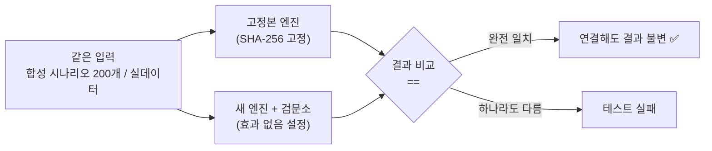
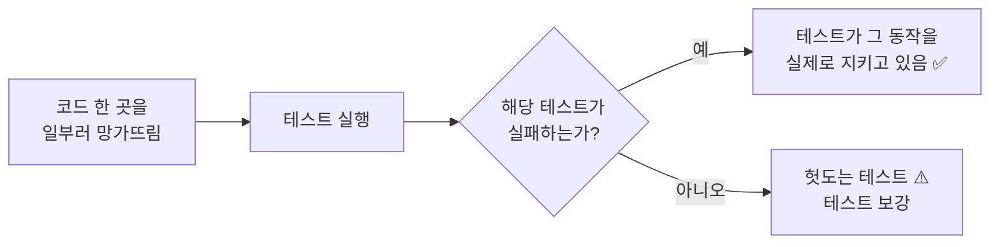
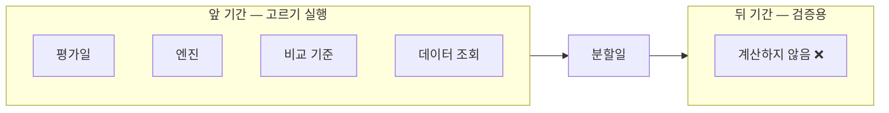

> 작업 기간: 2026-10-12 ~ 2026-10-18 (2026-10-18 정리)
>
> 이 글은 모의투자용 자동매매 시스템을 만드는 개발 기록이다. 투자 성과나 종목 추천이 아니며, 이번 작업의 테스트는 수익률을 출력하지 않는다.

## 들어가며

[지난주 글](/posts/risk-guardrail-checkpoint/)에서 주문 전에 반드시 지나는 리스크 검문소를 만들었다. 이번 주에는 그 검문소를 백테스트 엔진에 실제로 연결했다.

엔진의 핵심 반복문을 갈아 끼우는 작업이라 위험이 크다. 그래서 원칙을 하나 정했다. **"검문소를 꺼 두면 결과가 예전과 똑같다"를 먼저 증명하고, 그다음에 켠다.** 이 글은 그 증명을 어떻게 했는지에 대한 기록이다. 테스트는 이번 주에 3,176개에서 3,631개로 늘었다.

## 1. 비교 기준을 얼려 둔다: 엔진 고정본

"예전과 같다"를 증명하려면 "예전"이 바뀌지 않아야 한다. 그래서 바꾸기 직전의 엔진 파일을 **바이트 그대로 복사한 고정본**을 테스트 폴더에 두고, SHA-256과 파일 크기를 테스트로 고정했다. 누가 고정본을 한 글자라도 고치면 테스트가 실패한다.

그리고 반대 방향도 막았다. 제품 코드가 테스트 폴더를 import하면, 고정본이 실제 동작에 섞여 들어갈 수 있다. 제품 코드의 어느 파일도 테스트 패키지를 import하지 않는다는 것을 문법 트리(AST) 검사로 고정했다.

## 2. 동치 증명: 같은 입력, 같은 결과

- **합성 데이터**: 무작위로 만든 시나리오 200개에서 두 엔진의 결과가 완전히 같았다.
- **실데이터**: 앞 기간 8가지 조합에서 거래 수가 같았고, 검문소가 거절한 건수는 0이었다.

비교 기준도 강화했다. 금액을 비교할 때 원래는 `1e-12`의 오차를 허용했는데, 새 엔진의 계산식을 기존 엔진과 마지막 비트까지 맞춘 뒤 **`==` 완전 일치**로 바꿨다.

## 3. 일부러 망가뜨려 본다

테스트가 통과한다고 해서 테스트가 무언가를 지키고 있다는 보장은 없다. 아무것도 확인하지 않는 테스트도 통과하기 때문이다.

그래서 단계마다 **코드를 일부러 망가뜨린 변형**을 만들어, 해당 테스트가 실제로 실패하는지 확인했다. 흔히 뮤테이션 테스트라고 부르는 방식이다. 프로젝트에서는 "헛돎 확인"이라고 부른다.

예를 들어 지정가 체결 규칙을 "시가로 체결"로 바꿔 놓으면 테스트 6개가 실패했다. 망가뜨린 코드는 저장소 밖 임시 스크립트로만 만들어서, 실제 코드에 섞이지 않게 했다.

이 과정에서 실제로 빈틈을 찾기도 했다. 가드레일을 켠 실행과 끈 실행을 뒤바꿔도 통과하는 경우가 있었고, 테스트를 추가해 막았다. 모듈 import 경계를 검사하는 도구도, 위반 예시를 넣어 보니 특정한 import 형태를 놓치고 있었다. 이것도 보완했다.

## 4. 운영 코드와 백테스트를 섞지 않는다

백테스트는 과거를 재현하는 것이라, 실제 비상 정지 파일을 읽으면 안 된다. 그래서 백테스트 전용으로 "항상 꺼진" 비상 정지 상태를 따로 만들었다.

그런데 이 "항상 꺼진" 상태가 운영 코드로 새어 들어가면 위험하다. 실제 비상 정지가 무시될 수 있기 때문이다. 그래서 운영 경로의 파일 77개 어느 것도 백테스트 전용 모듈을 import하지 않는다는 것을 테스트로 고정했다.

같은 원칙으로 **테스트도 실제 설정 파일과 분리했다.** 예전에는 백테스트가 실제 리스크 설정 파일을 몰래 읽고 있어서, 설정을 바꾸면 무관한 테스트 결과가 바뀔 수 있었다. 이제 설정은 반드시 명시적으로 넘겨야 하고, 테스트 중에 실제 설정을 읽으려 하면 실패하게 했다.

## 5. 뒤 기간은 아예 계산하지 않는다

백테스트는 데이터를 앞 기간(전략을 고르는 데 쓰는 기간)과 뒤 기간(검증용)으로 나눈다. 앞 기간만 실행할 때 뒤 기간 결과가 화면에 보이지 않는 것만으로는 부족하다. 계산 중에 뒤 기간 데이터가 조금이라도 쓰이면, 그 정보가 전략 선택에 스며들 수 있다.

그래서 앞 기간만 실행하면 평가일, 엔진, 비교 기준, 데이터 조회가 **모두 분할일 전에서만 일어난다**는 것을 테스트로 증명했다. 또 앞 기간만 실행한 결과가 전체를 실행했을 때의 앞 기간 결과와 똑같다는 것도 확인했다.

## 6. 설정의 지문을 남긴다

같은 코드라도 리스크 설정이 다르면 결과가 다르다. 그래서 백테스트 보고서 맨 위에 **어떤 설정 파일로 돌렸는지와 그 파일의 SHA-256**을 남기고, 결과 CSV에도 해시 열을 붙였다. 해시는 운영체제 기본 도구로 계산한 값과 같은지 대조했다.

실행 전에는 "엔진을 몇 번 돌릴 예정인지"를 먼저 출력하고, 실제 실행 횟수와 다르면 오류로 멈춘다. 비교 축을 여러 개 켰을 때 조합이 조용히 빠지는 일을 막기 위해서다.

## 7. 조용히 0이 되는 곳 찾기

연결하는 동안 "오류 없이 조용히 틀리는" 곳도 두 군데 찾았다.

- **업종 정보가 없는 종목**: 예전에는 업종 한도 규칙이 그 종목을 조용히 거래 0건으로 만들었다. 이제는 신호를 계산하기 전에 멈추고 알려 준다.
- **날짜 함수에 시각이 들어온 경우**: 한 날짜 함수가 시간대가 있는 시각을 받으면 UTC 날짜로 바꿔, 다른 함수와 판단이 어긋났다. 날짜 함수 4개는 이제 시각을 받으면 오류를 낸다.

## 한계

- 실데이터 동치 확인은 오래 걸려서(수 분~십여 분) 기본 테스트에서 빼고, 사람이 따로 실행한다.
- 업종 분류는 과거 시점이 아니라 현재 기준이다.
- 지금 리스크 설정은 "효과 없음" 값이라 검문소를 켜도 결과가 같다. 실제 값을 정하는 것은 다음 단계다.

## 마치며

이번 주에 쓴 테스트 대부분은 "새 기능이 동작한다"가 아니라 **"바꾼 것이 아무것도 바꾸지 않았다"**를 증명하는 테스트였다. 고정본으로 기준을 얼리고, 완전 일치로 비교하고, 일부러 망가뜨려 테스트가 헛돌지 않는지 확인하고, 설정의 지문을 남겼다.

다음 단계는 리스크 설정에 실제 값을 넣는 일이다. 그 값도 앞 기간 데이터로만 정할 계획이다.
