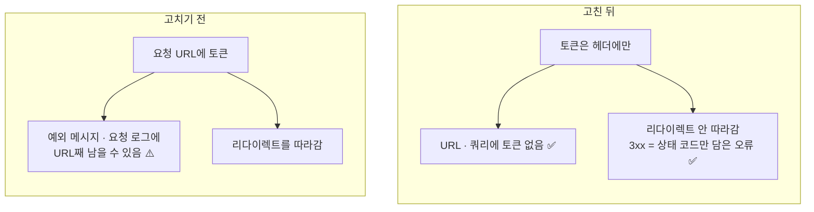
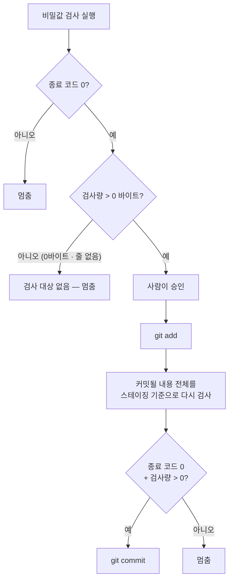

> 작업 기간: 2026-10-13 ~ 2026-10-18 (2026-10-18 정리)
>
> 이 글은 모의투자용 자동매매 시스템을 만드는 개발 기록이다. 투자 성과나 종목 추천이 아니다.

## 들어가며

[지난 글](/posts/threat-model-supply-chain/)에서 세운 위협 모델에는 비밀값이 새는 시나리오가 여럿 있었다. 이번 주에는 그중 세 가지를 막았다. 토큰이 URL에 실리는 경로, 보안 판정이 기록되지 않는 문제, 커밋에 비밀값이 섞여 들어가는 경로다.

그리고 막는 장치를 만든 바로 다음 날, 그 장치가 **0바이트를 검사하고 "통과"를 낸 사건**이 있었다. 이 글의 중심은 그 사건이다.

## 1. 토큰은 URL에 싣지 않는다

한 데이터 제공자 API는 인증 토큰을 URL 쿼리(`?token=...`)로 보내고 있었다. 마스킹 장치는 이미 있었지만, URL은 예외 메시지나 요청 로그처럼 생각지 못한 곳에 통째로 남기 쉽다.

그래서 토큰을 **전용 인증 헤더**로 옮겼다. 토큰 값을 꺼내는 곳은 헤더를 만드는 한 줄뿐이다.

옮기는 김에 코드 검토에서 하나가 더 지적됐다. HTTP 라이브러리는 다른 호스트로 리다이렉트될 때 표준 `Authorization` 헤더는 지우지만, **직접 만든 헤더는 그대로 따라 보낸다**(문서 기준). 응답이 리다이렉트되면 토큰이 엉뚱한 서버로 갈 수 있다는 뜻이다. 그래서 리다이렉트를 따라가지 않게 하고, 3xx 응답은 상태 코드만 담은 오류로 처리했다. 토큰도, 이동할 주소도 오류에 담지 않는다.



새 테스트 3개로 고정했다. "토큰은 헤더에만 있고 URL과 쿼리에는 없다", "리다이렉트를 따라가지 않는다", "리다이렉트 오류에 토큰과 이동 주소가 없다"이다. 실제 서버에서도 헤더 인증만으로 정상 응답이 오는 것을 확인했다.

헤더로 옮겼다고 끝은 아니다. 프록시나 디버그 도구에는 헤더도 보인다. 줄어든 것은 "URL이 남는 경로"라고 범위를 적어 두었다.

## 2. 보안 판정을 기록한다: 감사 로그

AI 도구의 명령을 막는 훅은 지금까지 판정만 하고 기록을 남기지 않았다. 나중에 "그때 무엇이 왜 막혔는지" 되짚을 방법이 없었다.

이제 훅은 거부(deny)나 확인 요청(ask)을 낼 때마다 로그에 한 줄을 남긴다. 예를 들어 카나리아 명령이 막히면 이런 줄이 남는다(시각은 예시).

```text
<UTC 시각> guard Bash deny canary
```

- **남기는 것**: UTC 시각, 훅 이름, 도구, 판정, 규칙 이름
- **남기지 않는 것**: 명령 원문, 경로, 이유 문장. 명령 원문에 민감한 값이 섞여 있을 수 있기 때문이다.

이 기록이 가능하도록 모든 판정에 **규칙 이름**을 붙였다. 판정을 만드는 곳마다 규칙 이름을 필수로 넣게 했고, 이름은 24개로 정리했다.

로그 자체도 보호 대상이다. AI가 기록을 지우거나 고치면 감사 로그가 의미 없어지기 때문이다. 그래서 로그 파일과 로그 폴더를 쓰거나 지우거나 옮기는 명령은 비상 정지 파일과 같은 방식으로 **거부**한다. `rm logs/*`처럼 넓은 패턴이 로그 파일을 포함하는 경우도 막는다. 읽기는 허용한다.

기록에 실패해도 판정에는 영향이 없게 했다. 로그 때문에 보안 판정이 흔들리면 안 되기 때문이다. 테스트는 84개를 추가했고, 테스트가 실제 로그 파일을 건드리지 않도록 시험용 폴더로 돌렸다.

## 3. 커밋 전 비밀값 검사, 그리고 0바이트 사건

커밋 전 점검 명령(`/commit-check`)에 **비밀값 검사 단계**를 넣었다. 바뀐 줄과 새 파일을 gitleaks로 검사하고, 종료 코드로 판정한다.

| 종료 코드 | 판정 |
| --- | --- |
| 0 | 통과 |
| 3 | 비밀값 발견 → 멈춤 (규칙·파일·줄만 보고, 값은 옮기지 않음) |
| 그 밖 | 도구 오류 → 멈춤 |

"찾음"을 1이 아닌 3으로 따로 지정했다. 기본값 1을 쓰면 "찾음"과 "도구 오류"를 구분할 수 없기 때문이다. 도구를 일부러 없앤 상태, 가짜 키를 넣은 상태에서도 시험해 각각 멈추는 것을 확인했다.

### 사건: 0바이트를 검사하고 통과

다음 날, 한 커밋을 점검하는 중에 이상한 점이 보였다. 비밀값 검사가 종료 코드 0으로 "통과"를 냈는데, 출력을 보니 **검사한 양이 0바이트**였다.

원인은 검사 시점이었다. 파일을 이미 스테이징한 뒤라서, "작업 트리의 변경분"을 보는 검사에는 남은 변경이 없었다. 검사 대상이 비어 있었는데 도구는 "찾은 것 없음"이라고 성공을 돌려준 것이다.

**검사를 하지 않은 것과 검사해서 깨끗한 것은 다르다.** 그래서 두 가지를 바꿨다.



1. 명령마다 **검사량 줄**을 확인하고, 0이거나 줄이 없으면 "검사 대상 없음"으로 멈춘다.
2. 사람이 승인하고 `git add`를 한 다음, 커밋하기 직전에 **실제로 커밋될 내용 전체를 한 번 더 검사**한다.

> 배운 점: 성공 종료 코드는 "문제가 없다"가 아니라 "도구가 문제를 못 찾았다"는 뜻이다. 검사한 양까지 확인해야 검사를 믿을 수 있다.

## 4. git 별명으로 돌아가는 길 막기

AI 도구의 `git push`는 이미 막혀 있었다. 이번에는 **같은 일을 다른 이름으로 하는 경로**를 막았다.

- git 별명(alias)을 즉석에서 만들어 push를 다른 이름으로 부르는 경로. 대소문자를 섞어도 같은 규칙으로 판정한다.
- push 대신 쓸 수 있는 저수준 전송 명령
- git 설정 쓰기, 설정 파일 직접 쓰기 → 확인 요청
- 작업 트리를 버리는 명령(`reset --hard` 등) → 확인 요청

테스트는 43개를 추가했다. 그리고 규칙을 하나씩 지워 보며, 그 규칙에 해당하는 테스트만 실패하는지 16가지로 확인했다. 테스트가 정말 그 규칙을 지키고 있는지 보기 위해서다.

## 5. 확인 창이 정말 뜨는가

규칙 파일에 "확인 요청"이라고 적는 것과 실제 화면에 확인 창이 뜨는 것은 다른 문제다. 그래서 이번 주 커밋마다 `git add`, 비밀값 재검사, `git commit`에서 확인 창이 떴는지 캡처로 관찰했다.

5번 연속으로 세 확인 창이 모두 뜨는 것을 확인했다. 다만 그 전에는 재검사 단계의 확인 창이 뜨지 않은 경우가 있었고, 가장 최근 커밋에서는 일부 확인 창을 캡처하지 못했다. 원인을 모르는 것은 "미확인"으로 남기고, 다음 커밋부터 계속 관찰하기로 했다.

## 한계

- 헤더 인증도 프록시나 디버그 도구에는 보인다.
- 감사 로그에는 확인 요청을 사람이 승인했는지 거절했는지는 남지 않는다. 훅이 시작조차 못 하면 기록도 없다.
- 비밀값 검사는 도구의 규칙에 없는 형태는 못 찾고, 점검 명령을 거치지 않은 커밋은 검사하지 않는다.
- git 쓰기 경로 중 아직 막지 않은 후보가 남아 있다. 다음 작업으로 기록해 두었다.

## 마치며

이번 주에 가장 오래 남을 교훈은 0바이트 사건이다. 보안 장치를 만들었다는 사실보다, 그 장치가 **실제로 무언가를 검사했는지**를 확인하는 습관이 더 중요했다.

다음 글에서는 같은 주에 한 다른 작업, 지난주에 만든 리스크 검문소를 백테스트 엔진에 연결하면서 "결과가 바뀌지 않았다"를 증명한 과정을 다룬다.
