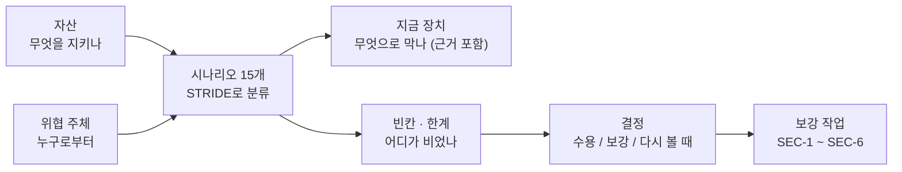
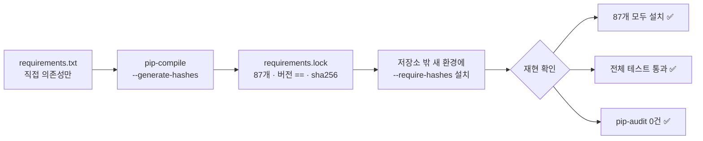

> 작업 기간: 2026-10-12 ~ 2026-10-13 (2026-10-18 정리)
>
> 이 글은 모의투자용 자동매매 시스템을 만드는 개발 기록이다. 투자 성과나 종목 추천이 아니다.

## 들어가며

지금까지 보안 장치는 "사건이 나면 막는" 방식으로 늘어 왔다. AI가 `.env`를 읽자 권한 규칙과 훅을 만들었고, 그 훅을 AI가 고칠 수 있다는 것을 알고 나서야 자기 보호를 넣었다.

이번 주에는 순서를 바꿨다. 먼저 **위협 모델**을 세워 전체 그림을 그리고, 거기서 빈칸을 찾아 보강 작업 여섯 개(SEC-1~6)를 정했다. 이 글은 그중 앞의 세 가지, 위협 모델과 비밀값 이력 검사, 공급망 잠금을 다룬다.

## 1. 위협 모델: 한 문서에 네 가지 질문

위협 모델 문서는 네 가지 질문에 답하도록 짰다. **무엇을, 누구로부터, 무엇으로 지키고, 어디가 비어 있는가.**

**자산**은 8가지로 나눴다. API 키와 토큰, 앞으로 생길 주문 권한, 데이터 무결성, 설정 무결성, 그리고 "검증 기준"까지 자산으로 넣었다. 테스트 기대값이 몰래 약해지면 틀린 코드가 통과하기 때문이다.

**위협 주체**는 6가지다.

| 주체 | 성격 |
| --- | --- |
| AI 코딩 도구의 오작동 | 악의는 없다. 지시 오해, 과잉 실행, 테스트를 약하게 바꿔 "통과"시키기 |
| 프롬프트 인젝션 | 공시·뉴스·웹 문서 속 문장이 AI에게 지시를 흘림 |
| 공급망 | 패키지 변조, 취약점, 의존성 버전 표류 |
| 외부 공격자 | 계정 탈취, 유출된 키 악용 |
| 사용자 실수 | 키를 코드나 채팅에 붙여넣기, 잘못된 설정 커밋 |
| 데이터 소스 변화 | 형식 변경이나 빈 응답이 조용히 들어옴 |

이 두 축을 엮어 **시나리오 15개**를 만들고, 각각을 STRIDE(위장·변조·부인·정보 유출·서비스 거부·권한 상승)로 분류했다. 시나리오마다 "지금 장치는 무엇이고 근거는 어느 파일 몇 번째 줄인지", "빈칸은 무엇인지"를 나란히 적었다.

초안을 쓴 뒤 줄 번호 근거를 실제 파일과 하나씩 대조했고, 맞지 않는 곳 3건을 고쳤다. 근거가 틀린 위협 모델은 오히려 안심만 시키기 때문이다.

### 막지 않기로 한 것도 결정으로 남긴다

모든 빈칸을 다 막을 수는 없다. 그래서 "지금은 막지 않는다"도 근거와 함께 결정으로 기록했다.

- **OS 수준 샌드박스는 지금 범위 밖이다.** 개발 도구의 샌드박스는 네이티브 Windows에서 동작하지 않는다(공식 문서 확인). 다른 환경으로 옮기면 경로와 측정 코드가 바뀌어 얻는 것보다 잃는 것이 크다. 실매매 봇을 상시 운영할 때 다시 본다.
- **키를 OS 키체인으로 옮기지 않는다(지금).** 같은 PC, 같은 사용자 권한이라 얻는 것이 적다. 실전 키를 도입할 때 다시 본다.
- **훅 내부 오류는 "확인 요청"으로 둔다.** "거부"로 바꾸면 훅 버그 하나로 모든 작업이 멈춘다. 엄밀한 fail-closed가 아니라는 한계도 함께 적었다.

> 배운 점: 위협 모델은 "막은 것 목록"이 아니라 "빈칸 목록"이다. 그리고 막지 않기로 한 결정도 근거와 "다시 볼 때"를 붙여 남긴다.

## 2. 과거 커밋에 비밀값이 있는가: 이력 전체 검사

첫 보강 작업은 커밋 이력 전체를 비밀값 검사 도구(gitleaks)로 훑는 것이었다. 결과 자체가 유출 경로가 되지 않도록 값은 가려서(redact) 출력했다.

| 검사 | 결과 |
| --- | --- |
| 이력 71개 커밋 | 9건 발견 → 모두 테스트의 마스킹 시험용 **가짜 값** |
| 실제 키 값 대조 (값 출력 없이) | 이력 0건, 현재 파일 0건 → **유출 없음** |

가짜 값 9건은 예외 목록에 등록했다. 다만 "테스트 폴더 전체 제외"처럼 넓게 빼지 않고, **한 건씩 지문으로 등록하고 줄마다 이유를 달았다.** 폴더째 빼면 나중에 그 폴더에 진짜 키가 들어가도 못 잡기 때문이다.

검사의 한계도 함께 적었다. 글자 그대로 일치하는 것만 대조했고, 아주 짧은 값과 바이너리 파일은 검사하지 않았다.

## 3. 공급망: 취약점 검사와 해시 잠금

### 취약점 검사

의존성 취약점 검사(pip-audit)에서 **12개**가 나왔다. 패키지 관리 도구 자체와 인증 라이브러리 쪽이었고, 업그레이드 후 **0개**가 됐다. 업그레이드 뒤 전체 테스트 결과는 그대로였다.

### 쓰지 않는 것을 지운다

조사해 보니 한 라이브러리의 "AI 기능 옵션"을 설치하고 있었는데, 코드에서는 전혀 쓰지 않았다. 이 옵션 하나가 **11개 패키지**를 더 끌어오고 있었다. 옵션을 지워 공격면을 줄였다.

### 해시로 잠근다

버전만 고정하면 같은 버전 번호로 내용이 바뀐 패키지를 막지 못한다. 그래서 모든 패키지를 **정확한 버전 + SHA-256 해시**로 잠갔다.

`--require-hashes`로 설치하면, 해시가 하나라도 맞지 않는 패키지는 설치 자체가 실패한다.

잠금 파일이 깨지지 않도록 **형식 테스트 15개**도 붙였다. 모든 줄에 정확한 버전과 해시가 있는지, 지운 옵션의 패키지가 다시 들어오지 않았는지를 확인한다. 테스트 15개 중 9개는 일부러 잘못 만든 예시 파일이다. 테스트가 실제로 실패를 잡는지 확인하기 위해서다.

## 한계

- 잠금 파일은 지금 운영체제와 파이썬 버전 전용이다.
- 새로 발표되는 취약점은 정기적으로 검사하지 않는다. 사람이 직접 도구를 실행해야 한다.
- 위협 모델의 빈칸 중 일부는 결정에 따라 지금 막지 않았고, 확인하지 못한 항목은 문서에 따로 모아 두었다.

## 마치며

사건이 생길 때마다 막는 방식은 빠르지만, 어디가 비어 있는지는 알려 주지 않는다. 위협 모델을 한 장 세워 두니 다음에 할 일(SEC-4~6)이 자연스럽게 정해졌다.

다음 글에서는 그 나머지 세 가지를 다룬다. 토큰이 URL로 새는 경로, 보안 판정을 남기는 감사 로그, 그리고 커밋 전 비밀값 검사에서 겪은 "0바이트를 검사하고 통과" 사건이다.
