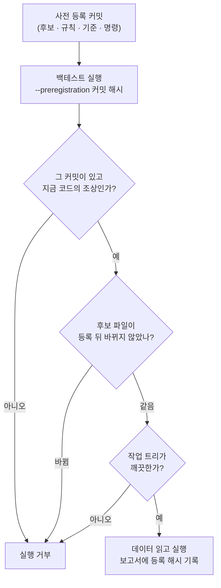
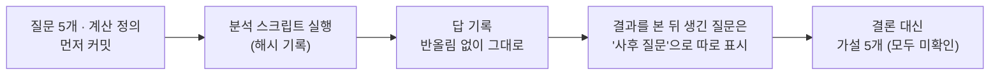

> 작업 기간: 2026-10-19 ~ 2026-10-22 (2026-10-25 정리)
>
> 이 글은 모의투자용 자동매매 시스템을 만드는 개발 기록이다. 투자 성과나 종목 추천이 아니며, 실험의 수익률이나 설정값은 다루지 않는다.

## 들어가며

백테스트에서 가장 쉬운 속임수는 자기 자신을 속이는 것이다. 여러 설정을 돌려 보고, 결과가 좋은 것을 고르고, 그 기준을 처음부터 그렇게 정했던 것처럼 믿는 일이다.

이번 주에는 그걸 막는 장치를 만들고 실제로 한 번 실험했다. 결과는 **실패**였다. 이 글은 실험을 어떻게 고정했는지, 그리고 실패를 어떻게 기록했는지에 대한 이야기다.

## 1. 결과를 보기 전에 등록한다

실험 전에 문서 하나를 커밋했다. 이 커밋이 **사전 등록**이다.

- 비교할 후보 설정 18개
- 그중 하나를 고르는 규칙과 동점일 때의 우선순위
- "성공"의 기준과, 아무것도 기준을 못 넘으면 "실패"라는 정의
- 실험에 쓸 데이터 범위와 제외 규칙
- 실행할 명령 전부
- 실패하면 같은 기간에서 다시 고르지 않는다는 규칙

결과가 나온 뒤에는 이 문서의 본문을 고치지 않는다. 덧붙이기만 한다.

## 2. 문서가 아니라 코드로 강제한다

문서에 적어 두는 것만으로는 약하다. 실행할 때 슬쩍 다른 후보 파일을 쓰거나, 등록 뒤에 파일을 고쳐도 아무도 모른다.

그래서 백테스트가 **사전 등록 커밋의 해시를 받아야만 실행**되게 했다. 데이터를 읽기 전에 git으로 다음을 확인하고, 하나라도 어긋나면 멈춘다.

검사에는 git의 **읽기 명령만** 쓴다. 저장소를 바꾸는 명령은 쓰지 않는다. 보고서 맨 위와 결과 CSV에도 등록 해시가 남아서, 나중에 "이 결과는 어떤 약속으로 돌렸는가"를 되짚을 수 있다.

이 검사는 가짜 git과 실제 임시 git 저장소, 양쪽으로 테스트했다. 테스트 124개를 추가했고, 검사를 일부러 망가뜨린 변형 14가지가 모두 잡히는 것도 확인했다.

### 데이터에도 지문을 남겼다

같은 후보라도 데이터가 바뀌면 결과가 바뀐다. 그래서 실험용 데이터를 사본으로 떠 두고 그 SHA-256을 기록했다. 점검에 쓴 스크립트도 바이트 그대로 저장소에 남기고 해시를 적었다. 해시를 기록하는 파일은 줄바꿈 자동 변환 대상에서 빼서, 운영체제가 바뀌어도 해시가 달라지지 않게 했다.

## 3. 결과: 실패

실험은 등록한 명령 그대로 한 번 돌렸다. 숫자는 선택 스크립트가 판정을 낸 뒤에야 처음 봤다.

**18개 후보 중 성공 기준을 넘은 것이 하나도 없었다.** 스크립트는 "실패" 종료 코드를 냈다.

이때 할 수 있는 일은 몇 가지가 있었다. 기준을 조금 낮추거나, 후보를 몇 개 더 넣거나, 기간을 바꿔 다시 돌리는 것이다. 그런데 그렇게 하면 앞에서 만든 장치가 모두 의미 없어진다. 그래서 등록한 대로 했다.

- 사전 등록 본문은 **한 줄도 고치지 않았다.** 삭제한 줄은 0이고, 맨 끝에 "결과 — 실패" 절만 덧붙였다.
- 같은 기간에서 **다시 고르지 않았다.**
- 리스크 설정은 바꾸지 않았다. 성공했다면 이어졌을 다음 단계도 시작하지 않았다.
- 다음 방향은 이 기록과 분리해서, **새 사전 등록**으로 정하기로 했다.

> 배운 점: 실패를 기록하는 방식이 실험의 신뢰도를 결정한다. 실패한 실험을 지우지 않고 남겨 둬야, 성공한 실험도 믿을 수 있다.

## 4. 원인 진단도 결과보다 질문이 먼저

실패했으니 원인을 알고 싶었다. 하지만 결과를 보면서 질문을 만들면, 결국 보고 싶은 답에 맞춰 질문을 고르게 된다.

그래서 진단도 같은 순서로 했다.

- 질문 5개와 계산 정의를 **결과를 보기 전에** 먼저 커밋했다. 이미 알고 있던 정보가 무엇인지도 미리 적어 두었다.
- 결과를 본 뒤 하나가 더 궁금해졌다. 이 질문은 "사후 질문"으로 표시해 앞의 다섯 개와 구분했다.
- 분석 스크립트는 수정 전후 두 판 모두 해시를 남겼다.
- 진단은 **판정이 아니라 가설**로 끝냈다. 가설 다섯 개 모두 "확인 안 됨"이고, 각각 무엇을 보면 확인할 수 있는지 적었다.
- 진단하는 동안에도 검증용 뒤 기간 데이터는 열지 않았다.

## 한계

- 사전 등록은 "등록한 뒤에 바꾸지 않았다"를 보장할 뿐, 등록 전에 이미 데이터를 본 영향까지 없애지는 못한다. 그래서 이미 알고 있던 정보를 문서에 따로 적었다.
- 데이터는 현재 살아 있는 종목 기준이라 생존 편향이 있고, 업종 분류도 현재 기준이다.

## 마치며

이번 주에 만든 것은 결국 "나중의 나를 믿지 않는 장치"다. 결과를 본 나는 기준을 바꾸고 싶어 한다. 그래서 결과를 보기 전의 나에게 결정을 맡기고, 그 결정을 git 해시로 묶어 두었다.

실험은 실패했지만, 실패가 정직하게 기록됐다는 점에서는 이번 주 작업이 성공했다고 생각한다. 다음 글에서는 같은 원칙을 매주 운영으로 옮긴 것, 즉 판단을 결과보다 먼저 남기는 가상 장부를 다룬다.
