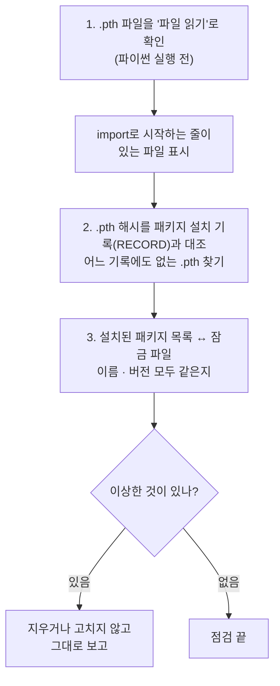
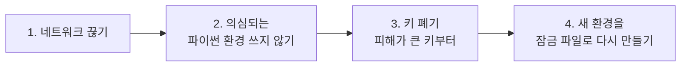

> 작업 기간: 2026-10-19 ~ 2026-10-25 (2026-10-25 정리)
>
> 이 글은 모의투자용 자동매매 시스템을 만드는 개발 기록이다. 투자 성과나 종목 추천이 아니다.

## 들어가며

지금까지의 보안 작업은 대부분 "만드는" 일이었다. 훅, 검사, 잠금 파일, 장부. 그런데 이 장치들은 사람이 정해진 방식으로 쓸 때만 동작한다. 그래서 이번 주에는 짧게, **운영 규칙**을 문서 하나로 정리했다. 설치할 때, 점검할 때, 그리고 무언가 의심될 때 무엇을 어떤 순서로 하는지다.

## 1. 설치는 한 가지 방법으로만

- 프로젝트 환경은 **해시로 잠근 파일로만** 설치한다. [2주 전에 만든](/posts/threat-model-supply-chain/) 잠금 파일이다.
- 패키지 하나만 따로 설치하는 명령은 쓰지 않는다. 잠금 파일 밖의 패키지가 섞이면 잠금의 의미가 없어진다.

### 새 패키지를 추가할 때: 슬롭스쿼팅 대비

AI 코딩 도구는 가끔 **존재하지 않는 패키지 이름**을 그럴듯하게 추천한다. 공격자가 그런 이름을 미리 선점해 악성 패키지를 올려 두는 공격을 슬롭스쿼팅(slopsquatting)이라고 부른다.

그래서 새 패키지는 이 순서로만 추가한다.

1. 사람이 추가를 승인한다.
2. 사람이 패키지 저장소 페이지에서 **이름 철자, 배포자, 첫 릴리스 날짜**를 직접 확인한다.
3. 그다음에야 의존성 목록에 넣고 잠금 파일을 다시 만든다.

AI 도구는 승인 없이 패키지, 플러그인, 확장 기능을 설치할 수 없다. 그런 승인 창이 뜨면 거절하고 먼저 묻는다.

### 갓 올라온 버전은 기다린다

악성 버전은 올라온 직후에 발견되어 내려가는 경우가 많다. 그래서 잠금 파일을 갱신할 때 **올라온 지 7일이 안 된 버전은 넣지 않는다**는 규칙을 정했다.

도구에 이를 위한 옵션이 있는 것은 확인했다. 다만 잠금 파일을 만드는 도구에 그 옵션을 넘기는 방법은 아직 시험하지 않았다. 그래서 문서에 "검증 전"이라고 적고, 확인될 때까지는 사람이 업로드 날짜를 직접 본다고 정했다.

## 2. 주기 점검: `.pth` 파일부터

새 패키지를 설치한 뒤, 그리고 한 달에 한 번 설치된 환경을 점검한다. 점검은 **읽기 전용**이다. 설치, 삭제, 수정, 네트워크 접속은 하지 않는다.

순서가 중요하다.

`.pth` 파일을 맨 먼저, 그것도 **파이썬을 실행하기 전에** 보는 데는 이유가 있다. 파이썬은 시작할 때마다 `.pth` 파일 안의 `import` 줄을 실행한다. 악성 코드가 숨기 좋은 자리라서, 점검하려고 파이썬을 실행하는 순간 이미 그 코드가 돌 수 있다. 그래서 파일 읽기로 내용부터 본다.

이상한 것을 발견해도 그 자리에서 지우지 않는다. 증거를 보존하고 사람이 판단한다.

## 3. 비밀값 규칙

- 키는 정해진 설정 파일에만 두고, AI 도구는 그 파일을 읽지 못한다.
- 용도가 다른 키는 서로 다른 키로 나눈다.
- 유료 API 키에는 월 사용 한도를 정한다.
- 실제 계좌 키는 지금 단계에서 만들지 않는다. 필요 없는 권한은 처음부터 존재하지 않게 한다.

## 4. AI가 외부 글을 읽을 때

앞으로 AI가 뉴스나 공시를 읽고 후보를 거르는 단계가 생길 예정이라, 원칙을 미리 정했다.

- 외부 글은 **명령이 아니라 데이터**다. 구분자로 감싸고, 구분자를 흉내 낸 문장은 무력화한다.
- AI의 출력은 정해진 형식(유지/제외와 이유)만 받는다. 형식 밖이면 버린다.
- AI에게 주문, 파일, 네트워크 권한을 주지 않는다.

프롬프트 인젝션을 완전히 막을 수는 없으니, **인젝션이 성공해도 할 수 있는 일이 없게** 만드는 쪽을 택했다.

## 5. 의심될 때의 순서

사고가 났을 때 당황하지 않으려면 순서를 미리 정해 두어야 한다.

가장 중요한 규칙은 하나다. **키 폐기와 재발급은 의심되는 PC가 아닌 다른 기기에서 한다.** 새 키도 의심되는 PC에는 저장하지 않는다. 감염된 PC에서 새 키를 발급하면 그 키도 바로 새어 나갈 수 있기 때문이다.

## 덤: 측정 도구도 정보를 흘리지 않게

같은 주에 백테스트 실행 시간을 재는 도구를 만들었다. 측정 결과에 실행 환경 정보를 함께 남기는데, 여기에 **사용자 이름, 호스트 이름, 경로는 넣지 않았다.** 출력은 정해진 숫자 항목만 받게 했고, 수익률이나 금액은 출력할 수 없게 막았다. 측정하다가 새 파일이 생기지 않았는지도 검사한다.

블로그에 측정 결과를 옮겨 적을 일이 생겨도, 처음부터 흘릴 것이 없으면 걱정할 일도 없다.

## 한계

- 갓 올라온 버전을 거르는 자동화는 아직 검증 전이고, 지금은 사람이 확인한다.
- 주기 점검은 사람이 기억해서 실행해야 한다.
- 이 문서는 절차일 뿐, 절차를 지켰는지는 기록과 사람의 확인에 기댄다.

## 마치며

보안 장치를 만드는 일은 눈에 보이는 결과가 있어서 재미있다. 운영 규칙은 그렇지 않다. 하지만 장치가 실제로 지켜 주는 것은 규칙대로 운영할 때뿐이다. 이번 주에는 그 규칙을, 특히 "의심될 때 무엇부터 하는가"를 미리 적어 두었다.
