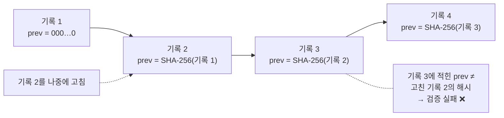
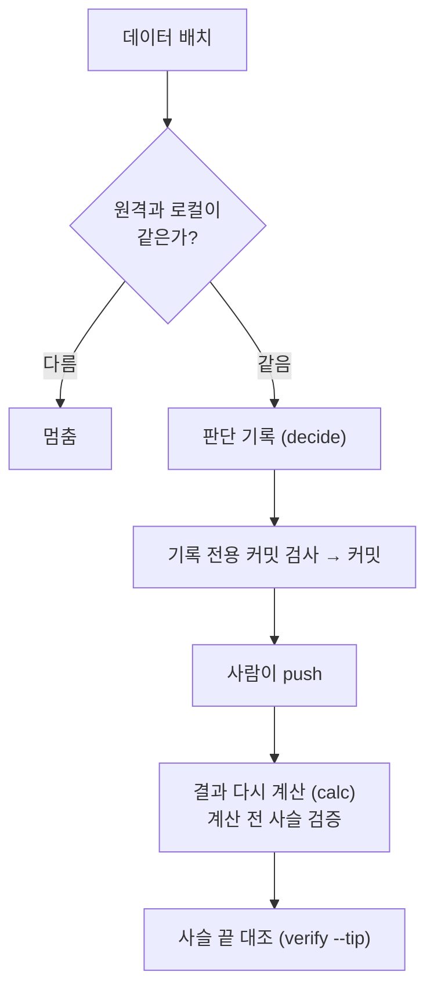

> 작업 기간: 2026-10-23 ~ 2026-10-25 (2026-10-25 정리)
>
> 이 글은 모의투자용 자동매매 시스템을 만드는 개발 기록이다. 투자 성과나 종목 추천이 아니며, 장부는 실제 돈이 오가지 않는 가상 기록이다.

## 들어가며

[지난 글](/posts/preregistration-and-failure/)에서는 결과를 보기 전에 실험을 등록해, 기준을 나중에 바꾸지 못하게 했다. 이번에는 같은 원칙을 **매주 운영**으로 옮겼다.

앞으로 시스템은 매주 "이번 주에 무엇을 살지"를 판단한다. 실제로 사지는 않고 **가상 장부**에 적어 두고, 몇 주 뒤에 그 판단이 어땠는지 계산한다. 문제는 이 기록을 나중에 고칠 수 있다면 의미가 없다는 점이다. 결과를 본 뒤에 판단을 슬쩍 바꾸면 늘 좋은 판단만 남는다.

그래서 이 장부의 목표는 하나다. **기록을 고칠 수 없게 만들기보다, 고치면 반드시 드러나게 만든다.** 보안에서 말하는 변조 탐지(tamper-evident)이고, STRIDE로는 "부인(Repudiation)"을 막는 장치다.

## 1. 판단은 결과보다 먼저, 파일로 남긴다

설계의 출발점은 순서다.

1. 판단 기준일이 되면 그 주의 판단을 **기록 파일**로 쓴다.
2. 기록 파일을 git에 **커밋**하고, 사람이 **push**한다.
3. 결과(가상 체결, 일별 평가액, 시장 지수 대비)는 기록과 그때의 데이터로 **매번 다시 계산**한다.

결과를 저장하는 데이터베이스는 "파생물"이다. 언제 지워도 기록 파일만 있으면 똑같이 다시 만들 수 있다. 진실의 원본은 기록 파일 하나뿐이다.

## 2. 해시 사슬로 묶는다

기록 파일은 한 줄짜리 JSON 레코드들로 되어 있다. 파일마다 **앞 파일의 SHA-256**을 담는다. 첫 파일은 0이 64개인 값을 담는다.

중간의 기록 하나를 고치면 그 파일의 해시가 바뀌고, 바로 다음 파일에 적힌 prev 값과 맞지 않게 된다. 검증 명령(`verify`)은 이런 것들을 잡는다.

- 해시 사슬이 끊긴 곳
- 일련번호가 빠지거나 순서가 바뀐 곳
- **갈라짐**: 같은 번호, 같은 prev를 가진 파일이 둘 있는 경우. 검증 도구는 어느 쪽이 맞는지 자동으로 고르지 않고 멈춘다.
- 기록 시각이 거꾸로 가는 곳

### 같은 내용은 같은 바이트로

해시는 바이트 하나만 달라도 바뀐다. 그래서 JSON을 **정규형**으로만 쓴다. 키 정렬, 고정 구분자, UTF-8, 끝 줄바꿈 하나로 맞추고 NaN은 허용하지 않는다. 읽을 때도 다시 직렬화해서 바이트가 같은지 확인한다. 중복 키처럼 해석이 갈릴 수 있는 입력은 거부한다.

운영체제에 따라 git이 줄바꿈을 바꿔 버리면 해시가 깨진다. 그래서 기록 파일은 줄바꿈 자동 변환 대상에서 뺐고, 실제 임시 git 저장소에서 변환 설정을 켠 채로 시험했다.

### 파일은 덮어쓰지 않는다

기록 파일은 "이미 있으면 실패"하는 모드로만 연다. 실수로 같은 이름의 파일을 덮어쓸 수 없다.

## 3. 마감과 비상 정지도 기록으로 남긴다

판단에는 **마감**이 있다. 마감 시각은 뉴욕 시장 시간 기준이라 서머타임에 따라 한국 시각이 바뀌는데, 이 계산은 별도 모듈로 만들고 7년 치 모든 날짜를 백테스트의 평가일 계산과 대조했다.

- 마감을 넘긴 판단은 버리지 않고 **"late"로 기록**한다. 그리고 결과 계산에서는 뺀다.
- 비상 정지 파일이 켜져 있으면 후보를 아예 만들지 않고, **"이번 주는 판단하지 않음"을 기록**한다.

"하지 않은 것"도 기록으로 남겨야, 나중에 빈 주가 왜 비었는지 설명할 수 있다.

## 4. 기록 파일 전용 커밋 검사

기록 파일은 일반 코드와 다른 전용 커밋 명령으로만 커밋한다. 커밋 전과 후에 읽기만 하는 검사가 돈다.

- 이번 커밋에 **새 기록 파일만** 들어가는가
- 이미 커밋된 기록이 디스크에서 바뀌지 않았는가, git이 변경을 무시하도록 표시된 기록은 없는가
- 이력에서 바뀐 기록이 없는가
- 한 커밋에는 한 주의 판단만 들어가는가
- 커밋 메시지가 정해진 형식인가

여기에 [지난주 글](/posts/secret-leak-paths/)에서 겪은 "0바이트 사건"의 교훈을 넣었다. 비밀값 검사의 검사량이 0이 아니어야 할 뿐 아니라, **대상 기록 파일의 바이트 합과 정확히 같아야** 통과한다. 검사량을 해석하지 못해도 실패로 본다. 이 식이 맞는지는 저장소 밖 임시 저장소에서 줄바꿈 설정 두 가지로 실측해 확인했다.

push는 이 명령에 넣지 않았다. 원격으로 보내는 일은 사람이 직접 한다.

## 5. 다시 계산해도 백테스트와 같다

장부로 계산한 결과가 백테스트와 다르면, 둘 중 하나는 틀렸다는 뜻이다. 그래서 같은 데이터로 매주 판단을 기록하고 장부로 다시 계산한 결과가, 백테스트 결과와 **정확히 일치**하는지 확인했다. 거래, 체결가, 수량, 현금, 평가액까지 비교했다.

- 진입·청산·주식 수 방식의 8가지 조합 모두 일치
- 판단 뒤에 주식 분할이 일어난 경우도 8가지 조합 모두 일치
- late·비상 정지 주는 계산에서 빠지는 것까지 확인

보고서에는 "좋다/나쁘다" 같은 **판정 문구를 넣지 않는다.** 숫자만 보여 준다. 판정 문구가 섞이지 않았는지는 보고서 코드의 문자열을 AST로 검사한다. 같은 결과면 같은 바이트의 보고서가 나오게 했고, 보고서 파일도 덮어쓰지 않는다.

이번 주에 장부 쪽에만 테스트가 수백 개 늘었고, 단계마다 코드를 일부러 망가뜨려 테스트가 잡는지 확인했다. 한 번은 망가뜨려도 테스트가 통과했는데, 따져 보니 그 변형은 결과에 영향을 줄 수 없는 경우(동등 변형)였다. 이것도 근거 줄 번호와 함께 기록했다.

## 6. 운영 runbook

도구가 아무리 꼼꼼해도, 매주 사람이 정해진 순서대로 해야 동작한다. 그래서 운영 문서를 따로 만들었다.

- 매주 순서와 명령별 종료 코드, 실패했을 때의 대응
- **하지 말 것**: 강제 push 계열, 전체 파일 add, 기록 파일 merge
- 갈라짐이 생겼을 때의 해결 절차: 먼저 push된 쪽을 정본으로 보고, 양쪽이 모두 저장소에 있으면 멈춘다
- 도구가 **잡는 경우와 못 잡는 경우**를 나눠 적고, 못 잡는 경우의 대응 단계를 적었다

## 한계

- 해시 사슬은 "고치면 드러나게" 할 뿐, 고치는 것 자체를 막지는 않는다. 도구만으로는 잡기 어려운 경우도 있어서, runbook에 한계와 사람이 확인할 단계로 적어 두었다.
- 정본 판단은 원격 저장소의 push 기록에 기대는 부분이 있다.
- 첫 실제 판단은 갈래 설정을 사전 등록한 뒤에 시작한다. 아직 실제 운영 기록은 없다.

## 마치며

이번 주의 장부는 결국 "나중의 나"에게서 과거의 판단을 지키는 장치다. 판단을 먼저 쓰고, 해시로 묶고, git으로 남기고, 결과는 언제든 다시 계산할 수 있게 했다.

보안에서 감사 로그와 무결성을 다루는 방식을 그대로 개인 프로젝트에 가져와 본 셈인데, 만들어 보니 생각보다 "기록 형식을 바이트 단위로 고정하는 일"이 가장 손이 많이 갔다.
