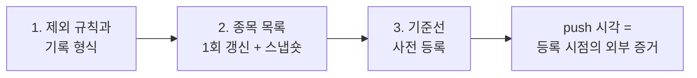

> 작업 기간: 2026-11-01 (2026-11-02 정리)
>
> 이 글은 모의투자용 자동매매 시스템을 만드는 개발 기록이다. 투자 성과나 종목 추천이 아니며, 종목 이름과 설정값은 다루지 않는다.

## 들어가며

[앞선 글](/posts/preregistration-and-failure/)에서는 백테스트를 사전 등록으로 고정했고, [그다음 글](/posts/tamper-evident-ledger/)에서는 매주 판단을 해시 사슬로 기록하는 가상 장부를 만들었다. 이제 장부로 **실제 관찰을 시작**할 차례다. 시작 직전에는 세 가지를 정해야 했다.

1. 데이터가 의심스러운 종목을 판단에서 뺄 때, 그 사실을 어떻게 남길까?
2. 관찰하는 동안 종목 목록은 어떻게 다룰까?
3. 관찰이 끝났을 때 성공과 실패를 가르는 기준은 무엇일까?

셋 다 결과를 보기 전에 정해야 의미가 있다. 이 글은 그 세 가지를 하루 동안 커밋 세 개로 고정한 기록이다.

## 1. 빼는 것도 기록한다

데이터가 의심스러운 종목이 있을 때 선택지는 둘이다. 전체를 멈추거나, 그 종목만 빼고 진행하거나. 둘 다 장단점이 있어서 규칙으로 정했다.

- **의심 종목이 5개 이하**: 그 종목의 데이터를 **메모리에서만** 숨기고 진행한다. 저장된 데이터 파일은 한 바이트도 바꾸지 않는다. 숨긴 종목은 "데이터가 아예 없는 종목"과 같은 경로로 빠진다.
- **6개 이상**: 전체 거부. 의심 종목이 이렇게 많으면 개별 종목이 아니라 데이터 적재 자체를 의심해야 한다.
- **지수 기준일 데이터가 없거나, 보정 전 데이터만 없는 경우**: 전체 거부. 종목 하나의 문제가 아니기 때문이다.

5라는 문턱은 **임의로 정한 값**이다. 근거 있는 최적값이 아니라는 점을 문서에 그대로 적었고, 바꿀 때는 새 결정 기록을 남기도록 했다. 이 문턱이 중요한 이유는 크기가 아니라 **"빼는 일에도 상한이 있다"**는 점이다. 상한이 없으면 "마음에 안 드는 종목은 데이터가 의심스럽다고 빼는" 길이 열린다.

### 뺀 종목은 판단 기록의 헤더에 남는다

제외가 있었던 판단은 기록 파일 헤더에 `excluded_tickers`를 넣는다. 각 항목에는 티커, 제외 이유(`bars_suspect` 또는 `no_data`), 마지막 데이터 날짜가 들어간다. 엄격한 규칙을 몇 개 붙였다.

- 제외가 있을 때만 칸을 만든다. 빈 목록이나 `null`은 거부한다.
- 티커 순서로 정렬하고 중복을 허용하지 않는다.
- 제외 종목이 후보에도 올라 있으면 거부한다(모순).
- 기존 기록 형식의 버전은 그대로 유지한다.

이 헤더도 해시 사슬에 묶인다. 나중에 "그때 왜 이 종목이 없었나"를 기록만으로 설명할 수 있고, 제외 기록을 지우면 사슬이 끊긴다.

### 보고서에도 "비어 있음"을 표시한다

보고서에는 두 가지 줄을 더했다.

- **빈 주**: 시작일부터 끝날 전까지의 평가일 중, 정상적으로 기록된 판단이 없는 날. 그날의 기록 상태를 같이 표시한다.
- **기록별 제외 종목**: 위 헤더의 내용.

값이 비어 있으면 줄 자체를 만들지 않아서, 기존 보고서는 바이트 그대로다. 다만 기존 골든 보고서에는 빈 주가 실제로 있어서 줄이 9개 늘었고, 그 해시 하나만 기대값을 바꿨다. 바꾼 이유는 커밋에 적고 사람이 확인했다. 계산 결과 자체는 제외 칸의 유무와 무관하다는 것도 테스트로 고정했다.

### 이번에도 문턱을 경계로 시험했다

- 문턱 5와 6의 경계
- 보정 전 데이터만 없을 때 거부(단독일 때와 의심 종목 5개와 함께일 때)
- 저장된 데이터 파일의 바이트 불변
- 기록 전용 커밋 검사(check-commit) 통과
- 일부러 망가뜨린 변형 11가지가 모두 잡히는지

## 2. 관찰 중에는 종목 목록을 고정한다

종목 목록이 관찰 중에 계속 바뀌면, 결과가 달라진 이유가 판단 때문인지 목록 때문인지 알 수 없다. 그래서 정했다.

- **목록은 장부 기간 동안 고정한다.**
- **시작 전에 딱 1번만 갱신한다.** 갱신은 사람이 직접 실행한다.
- 갱신 직후 **그날의 구성종목 스냅숏**을 별도 파일로 남기고, 현재 목록과 바이트가 같은지 확인한다. 스냅숏의 SHA-256도 기록해 둔다.

이번 갱신에서는 몇 종목이 추가되고 빠졌으며, 나머지는 "마지막 확인 날짜"만 바뀌었다. 업종이나 이름 같은 필드가 바뀌지 않았다는 것도 비교로 확인했다. 새로 들어온 종목은 아직 데이터가 없어서, **첫 판단 전에 데이터를 받아 오지 않으면 "데이터 없는 종목"으로 빠진다.** 이 경우를 위 규칙이 처리한다. 앞의 제외 규칙과 이어지는 부분이다.

## 3. 판정 기준을 시작 전에 등록했다

마지막은 [사전 등록](/posts/preregistration-and-failure/) 방식을 12개월 관찰에 적용한 것이다. 문서 하나와 설정 파일 둘, 테스트로 고정했다.

문서에 담은 것:

- 관찰의 목적과 비교 대상(이 관찰이 무엇을 확인하려는지)
- 갈래(비교할 설정)와 그 등록값, 고정값의 SHA-256
- 판단 규칙(앞에서 말한 제외 규칙 포함)
- 평가 계획: 관찰 기간은 **12개월**, 중간 점검은 **6개월 시점에 딱 1번**, 최종 판정은 **12개월 시점**
- 점검 때 쓰는 최대 낙폭 계산식을 문서에 명시
- 판정 규칙은 미리 **"차이가 0보다 크면 성공, 여유는 없음"**으로 적음
- 다시 등록하는 규칙: 기준을 바꾸려면 새 등록이 필요
- 알려진 한계 6개: 데이터의 반복 봉 문제는 **감지 코드를 만들지 않고 한계로만 기록**하기로 결정했다. 코드로 걸러 내면 오히려 그 코드가 판단에 영향을 주기 때문이다.
- 이 관찰의 모의 자본은 실제 투자금과 별개라는 점

설정 쪽에서는 이렇게 했다.

- 갈래 설정은 별도 파일에 두고, **리스크 설정은 원본이 아니라 바이트 복사본**을 쓰게 했다. 원본을 나중에 고쳐도 관찰 중인 장부는 영향을 받지 않는다. 등록 시점에 복사본과 원본이 같은지 확인했고, 복사본의 SHA-256을 고정했다.
- 테스트 22개로 고정값 SHA 4개, 갈래 항목 값, 장부 읽기, 점검일 규칙을 확인한다. 임시 사본에서 값을 일부러 바꿔 테스트가 실패하는지도 확인했다.
- 원본 리스크 설정과의 비교는 **영구 테스트에 넣지 않았다.** 원본을 정상적으로 고칠 수 있어야 하기 때문이다. 대신 갈래 개수도 단언하지 않아서, 다음 단계에서 갈래를 더해도 테스트가 깨지지 않는다. 고정할 것과 풀어 둘 것을 구분한 부분이다.

### 등록 시점은 어떻게 증명하나

사전 등록의 핵심은 "정말 그 전에 등록했는가"다. 내 컴퓨터의 커밋 시각은 내가 고칠 수 있으니 증거로 약하다.

그래서 **등록 시점의 코드 기준 커밋은 이 등록 커밋의 부모**로 고정하고, 이 커밋을 원격 저장소에 올린 **push 시각을 외부 증거**로 삼기로 문서에 적었다. 이 증거는 원격 저장소 서비스의 기록에 기대는 것이라 완벽하지는 않지만, 로컬 시계보다는 훨씬 믿을 만하다.

## 한계

- 5개라는 제외 상한과 판정 기준의 세부 값은 모두 임의로 정했다. 시작 전에 고정했다는 점이 의미일 뿐, 최적이라는 뜻은 아니다.
- 사전 등록은 "등록 후 바꾸지 않았다"를 보여 줄 뿐, 등록 전에 이미 알고 있던 정보의 영향까지 없애지는 못한다.
- 반복 봉처럼 감지하지 않기로 한 문제가 남아 있다.
- 종목 목록은 현재 살아 있는 종목 기준이라 생존 편향이 있다.
- push 시각은 원격 저장소 서비스의 기록에 기댄다.
- 아직 실제 관찰 기록은 없다. 이 글은 시작 **전**의 준비 기록이다.

## 마치며

이번 작업에서 새로 만든 건 대부분 "판단을 바꾸는 코드"가 아니라 "판단을 나중에 설명할 수 있게 하는 코드와 문서"였다. 뺀 종목, 빈 주, 고정한 목록, 미리 정한 판정 기준은 모두 같은 질문에서 나왔다. **결과를 본 뒤의 나는 어떤 방식으로 자신을 속일 수 있는가.**

지금까지 이 블로그에 쓴 장치(해시 사슬, 사전 등록, 헛돎 확인)가 이번 준비에서 한 번에 모였다. 다음에는 실제 관찰이 시작된 뒤에 기록이 어떻게 쌓이는지, 그리고 계획과 현실이 어긋났을 때 무엇을 남겼는지를 쓰려 한다.
---
title: "관찰을 시작하기 전에 계획을 등록했다: 제외한 종목도 기록하는 가상 장부"
description: "12개월 관찰의 판정 규칙을 시작 전에 고정하고, 판단에서 뺀 종목과 빈 주까지 기록으로 남긴 과정"
date: 2026-11-02 19:25:00 +0900
categories: [재현성, 무결성]
tags: [preregistration, audit, sha256, git, 재현성]
mermaid: true
---

> 작업 기간: 2026-11-01 (2026-11-02 정리)
>
> 이 글은 모의투자용 자동매매 시스템을 만드는 개발 기록이다. 투자 성과나 종목 추천이 아니며, 종목 이름과 설정값은 다루지 않는다.

## 들어가며

[앞선 글](/posts/preregistration-and-failure/)에서는 백테스트를 사전 등록으로 고정했고, [그다음 글](/posts/tamper-evident-ledger/)에서는 매주 판단을 해시 사슬로 기록하는 가상 장부를 만들었다. 이제 장부로 **실제 관찰을 시작**할 차례다. 시작 직전에는 세 가지를 정해야 했다.

1. 데이터가 의심스러운 종목을 판단에서 뺄 때, 그 사실을 어떻게 남길까?
2. 관찰하는 동안 종목 목록은 어떻게 다룰까?
3. 관찰이 끝났을 때 성공과 실패를 가르는 기준은 무엇일까?

셋 다 결과를 보기 전에 정해야 의미가 있다. 이 글은 그 세 가지를 하루 동안 커밋 세 개로 고정한 기록이다.

## 1. 빼는 것도 기록한다

데이터가 의심스러운 종목이 있을 때 선택지는 둘이다. 전체를 멈추거나, 그 종목만 빼고 진행하거나. 둘 다 장단점이 있어서 규칙으로 정했다.

- **의심 종목이 5개 이하**: 그 종목의 데이터를 **메모리에서만** 숨기고 진행한다. 저장된 데이터 파일은 한 바이트도 바꾸지 않는다. 숨긴 종목은 "데이터가 아예 없는 종목"과 같은 경로로 빠진다.
- **6개 이상**: 전체 거부. 의심 종목이 이렇게 많으면 개별 종목이 아니라 데이터 적재 자체를 의심해야 한다.
- **지수 기준일 데이터가 없거나, 보정 전 데이터만 없는 경우**: 전체 거부. 종목 하나의 문제가 아니기 때문이다.

5라는 문턱은 **임의로 정한 값**이다. 근거 있는 최적값이 아니라는 점을 문서에 그대로 적었고, 바꿀 때는 새 결정 기록을 남기도록 했다. 이 문턱이 중요한 이유는 크기가 아니라 **"빼는 일에도 상한이 있다"**는 점이다. 상한이 없으면 "마음에 안 드는 종목은 데이터가 의심스럽다고 빼는" 길이 열린다.

### 뺀 종목은 판단 기록의 헤더에 남는다

제외가 있었던 판단은 기록 파일 헤더에 `excluded_tickers`를 넣는다. 각 항목에는 티커, 제외 이유(`bars_suspect` 또는 `no_data`), 마지막 데이터 날짜가 들어간다. 엄격한 규칙을 몇 개 붙였다.

- 제외가 있을 때만 칸을 만든다. 빈 목록이나 `null`은 거부한다.
- 티커 순서로 정렬하고 중복을 허용하지 않는다.
- 제외 종목이 후보에도 올라 있으면 거부한다(모순).
- 기존 기록 형식의 버전은 그대로 유지한다.

이 헤더도 해시 사슬에 묶인다. 나중에 "그때 왜 이 종목이 없었나"를 기록만으로 설명할 수 있고, 제외 기록을 지우면 사슬이 끊긴다.

### 보고서에도 "비어 있음"을 표시한다

보고서에는 두 가지 줄을 더했다.

- **빈 주**: 시작일부터 끝날 전까지의 평가일 중, 정상적으로 기록된 판단이 없는 날. 그날의 기록 상태를 같이 표시한다.
- **기록별 제외 종목**: 위 헤더의 내용.

값이 비어 있으면 줄 자체를 만들지 않아서, 기존 보고서는 바이트 그대로다. 다만 기존 골든 보고서에는 빈 주가 실제로 있어서 줄이 9개 늘었고, 그 해시 하나만 기대값을 바꿨다. 바꾼 이유는 커밋에 적고 사람이 확인했다. 계산 결과 자체는 제외 칸의 유무와 무관하다는 것도 테스트로 고정했다.

### 이번에도 문턱을 경계로 시험했다

- 문턱 5와 6의 경계
- 보정 전 데이터만 없을 때 거부(단독일 때와 의심 종목 5개와 함께일 때)
- 저장된 데이터 파일의 바이트 불변
- 기록 전용 커밋 검사(check-commit) 통과
- 일부러 망가뜨린 변형 11가지가 모두 잡히는지

## 2. 관찰 중에는 종목 목록을 고정한다

종목 목록이 관찰 중에 계속 바뀌면, 결과가 달라진 이유가 판단 때문인지 목록 때문인지 알 수 없다. 그래서 정했다.

- **목록은 장부 기간 동안 고정한다.**
- **시작 전에 딱 1번만 갱신한다.** 갱신은 사람이 직접 실행한다.
- 갱신 직후 **그날의 구성종목 스냅숏**을 별도 파일로 남기고, 현재 목록과 바이트가 같은지 확인한다. 스냅숏의 SHA-256도 기록해 둔다.

이번 갱신에서는 몇 종목이 추가되고 빠졌으며, 나머지는 "마지막 확인 날짜"만 바뀌었다. 업종이나 이름 같은 필드가 바뀌지 않았다는 것도 비교로 확인했다. 새로 들어온 종목은 아직 데이터가 없어서, **첫 판단 전에 데이터를 받아 오지 않으면 "데이터 없는 종목"으로 빠진다.** 이 경우를 위 규칙이 처리한다. 앞의 제외 규칙과 이어지는 부분이다.

## 3. 판정 기준을 시작 전에 등록했다

마지막은 [사전 등록](/posts/preregistration-and-failure/) 방식을 12개월 관찰에 적용한 것이다. 문서 하나와 설정 파일 둘, 테스트로 고정했다.

문서에 담은 것:

- 관찰의 목적과 비교 대상(이 관찰이 무엇을 확인하려는지)
- 갈래(비교할 설정)와 그 등록값, 고정값의 SHA-256
- 판단 규칙(앞에서 말한 제외 규칙 포함)
- 평가 계획: 관찰 기간은 **12개월**, 중간 점검은 **6개월 시점에 딱 1번**, 최종 판정은 **12개월 시점**
- 점검 때 쓰는 최대 낙폭 계산식을 문서에 명시
- 판정 규칙은 미리 **"차이가 0보다 크면 성공, 여유는 없음"**으로 적음
- 다시 등록하는 규칙: 기준을 바꾸려면 새 등록이 필요
- 알려진 한계 6개: 데이터의 반복 봉 문제는 **감지 코드를 만들지 않고 한계로만 기록**하기로 결정했다. 코드로 걸러 내면 오히려 그 코드가 판단에 영향을 주기 때문이다.
- 이 관찰의 모의 자본은 실제 투자금과 별개라는 점

설정 쪽에서는 이렇게 했다.

- 갈래 설정은 별도 파일에 두고, **리스크 설정은 원본이 아니라 바이트 복사본**을 쓰게 했다. 원본을 나중에 고쳐도 관찰 중인 장부는 영향을 받지 않는다. 등록 시점에 복사본과 원본이 같은지 확인했고, 복사본의 SHA-256을 고정했다.
- 테스트 22개로 고정값 SHA 4개, 갈래 항목 값, 장부 읽기, 점검일 규칙을 확인한다. 임시 사본에서 값을 일부러 바꿔 테스트가 실패하는지도 확인했다.
- 원본 리스크 설정과의 비교는 **영구 테스트에 넣지 않았다.** 원본을 정상적으로 고칠 수 있어야 하기 때문이다. 대신 갈래 개수도 단언하지 않아서, 다음 단계에서 갈래를 더해도 테스트가 깨지지 않는다. 고정할 것과 풀어 둘 것을 구분한 부분이다.

### 등록 시점은 어떻게 증명하나

사전 등록의 핵심은 "정말 그 전에 등록했는가"다. 내 컴퓨터의 커밋 시각은 내가 고칠 수 있으니 증거로 약하다.

그래서 **등록 시점의 코드 기준 커밋은 이 등록 커밋의 부모**로 고정하고, 이 커밋을 원격 저장소에 올린 **push 시각을 외부 증거**로 삼기로 문서에 적었다. 이 증거는 원격 저장소 서비스의 기록에 기대는 것이라 완벽하지는 않지만, 로컬 시계보다는 훨씬 믿을 만하다.

## 한계

- 5개라는 제외 상한과 판정 기준의 세부 값은 모두 임의로 정했다. 시작 전에 고정했다는 점이 의미일 뿐, 최적이라는 뜻은 아니다.
- 사전 등록은 "등록 후 바꾸지 않았다"를 보여 줄 뿐, 등록 전에 이미 알고 있던 정보의 영향까지 없애지는 못한다.
- 반복 봉처럼 감지하지 않기로 한 문제가 남아 있다.
- 종목 목록은 현재 살아 있는 종목 기준이라 생존 편향이 있다.
- push 시각은 원격 저장소 서비스의 기록에 기댄다.
- 아직 실제 관찰 기록은 없다. 이 글은 시작 **전**의 준비 기록이다.

## 마치며

이번 작업에서 새로 만든 건 대부분 "판단을 바꾸는 코드"가 아니라 "판단을 나중에 설명할 수 있게 하는 코드와 문서"였다. 뺀 종목, 빈 주, 고정한 목록, 미리 정한 판정 기준은 모두 같은 질문에서 나왔다. **결과를 본 뒤의 나는 어떤 방식으로 자신을 속일 수 있는가.**

지금까지 이 블로그에 쓴 장치(해시 사슬, 사전 등록, 헛돎 확인)가 이번 준비에서 한 번에 모였다. 다음에는 실제 관찰이 시작된 뒤에 기록이 어떻게 쌓이는지, 그리고 계획과 현실이 어긋났을 때 무엇을 남겼는지를 쓰려 한다.
