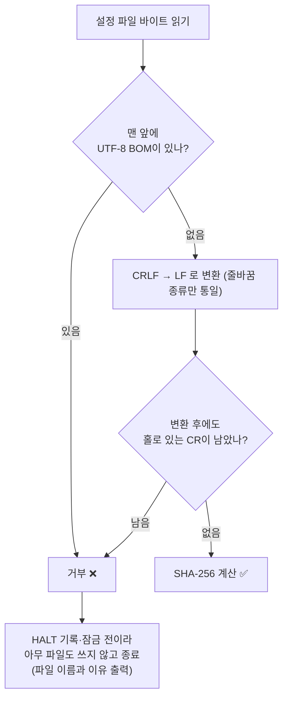
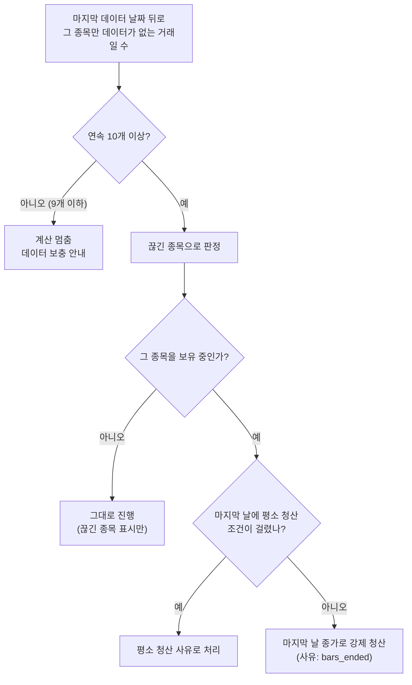

> 작업 기간: 2026-10-26 (2026-11-02 정리)
>
> 이 글은 모의투자용 자동매매 시스템을 만드는 개발 기록이다. 투자 성과나 종목 추천이 아니며, 특정 종목이나 설정값은 다루지 않는다.

## 들어가며

[지난 글](/posts/tamper-evident-ledger/)에서 가상 장부를 해시 사슬로 묶었다. 그런데 실제 운영을 앞두고 점검하다 보니, 장부가 기대고 있는 가정 두 개가 아직 비어 있었다.

1. **같은 설정 파일인데 환경마다 해시가 다르면?** 장부는 "어떤 설정으로 판단했는가"를 파일의 SHA-256으로 기록한다.
2. **보유하던 종목의 데이터가 어느 날 끊기면?** 상장폐지나 거래 정지가 대표적이다. 이때 어떻게 계산할지를 결과를 보고 정하면 안 된다.

둘 다 "첫 실제 판단을 기록하기 전에" 정해야 한다. 이 글은 그 결정과 검증을 정리한 기록이다.

## 1. 줄바꿈이 해시를 바꾼다

해시는 바이트 하나만 달라도 값이 바뀐다. 그런데 Windows는 줄 끝을 `\r\n`(CRLF), 다른 환경은 `\n`(LF)으로 쓴다. git 설정에 따라 체크아웃할 때 줄바꿈이 바뀌기도 한다. 결과적으로 **내용은 같은데 해시가 다른** 일이 생긴다.

장부에서는 이게 치명적이다. 한 환경에서 판단을 기록하고 다른 환경에서 결과를 다시 계산할 때, 설정 해시가 안 맞으면 "설정이 바뀌었다"로 보고 멈추기 때문이다. 반대로 해시를 무시하면 정말로 설정이 바뀐 것을 놓친다.

### 해시 전에 정규화하는 규칙

해시를 계산하기 전에 읽은 바이트에 다음 순서로 규칙을 적용한다.

- **CRLF는 LF로 하나만 바꾼다.** 줄바꿈 종류만 흡수하고, 다른 바이트는 건드리지 않는다.
- **BOM과 홀로 있는 CR은 거부한다.** 이런 바이트는 눈에 안 보이지만 해시를 바꾼다. "알아서 지워 주는" 대신 멈추게 했다. 모호한 입력은 통과시키지 않는 fail-closed 원칙이다.
- **거부는 기록 전에 일어난다.** 판단 기록을 쓰기 전에 멈추므로 반쯤 쓰인 파일이 남지 않는다.
- **계산 쪽도 같은 함수를 쓴다.** 판단을 기록하는 코드와 결과를 다시 계산하는 코드가 같은 해시 함수를 import한다. 규칙이 두 군데에 따로 있으면 언젠가 어긋난다.

고려한 다른 선택지도 있었다. 파일을 읽은 그대로 해시하고 줄바꿈은 git 설정으로 고정하는 방법이다. 이쪽은 설정이 하나 더 필요하고, 환경이 바뀔 때마다 사람이 설정을 기억해야 한다. **기억에 기대는 규칙보다 코드가 막는 규칙**이라는 이 블로그의 원칙에 따라 정규화 쪽을 골랐다. 선택의 근거와 고르지 않은 이유는 설계 문서에 적어 두었다.

### 테스트: 다른 줄바꿈으로 가도 같은가

이 규칙은 테스트 34개로 묶었다. 핵심은 다음 시나리오다.

- 같은 내용의 CRLF 파일과 LF 파일이 **같은 해시**를 낸다. 판단 기록 쪽과 재계산 쪽 모두.
- 한 줄바꿈 형식으로 판단을 기록하고, 파일을 **다른 형식으로 바꾼 뒤** 재계산해도 통과한다.
- BOM이 있거나 홀로 있는 CR이 있으면 두 경로 모두 거부한다.
- 기존 "골든 결과"(미리 고정한 기대 출력)는 해시에서 이어지는 값만 다시 만들었고, 나머지 출력은 그대로 두었다. 파라미터로 CRLF, LF 두 사본을 모두 돌린다.

## 2. 데이터가 끊긴 종목은 어떻게 계산하나

장부는 몇 주 동안 후보를 사고 보유한다. 그런데 보유 중인 종목의 가격 데이터가 어느 날부터 오지 않을 수 있다. 상장폐지, 인수합병, 거래 정지가 그 예다. 이때 계산이 멈추면 장부 전체가 멈추고, 임의로 가격을 채우면 결과를 믿을 수 없다.

### 결과를 보기 전에 규칙을 먼저 정했다

기준은 다음처럼 **자동 판정**으로 미리 고정했다.

- 시장 대표 지수(SPY)의 거래일 중에서, 어떤 종목의 마지막 데이터 날짜 뒤로 **그 종목만 데이터가 없는 거래일이 연속 10개 이상**이면 "끊긴 종목"이다.
- 10개 미만이면 끊긴 것으로 보지 않고, 예전처럼 **계산을 멈추고** 데이터를 더 받으라고 안내한다.
- 끊긴 종목을 보유 중이면 **마지막 데이터 날짜의 종가로 정리**한다. 그날 평소 청산 조건(손절·목표·최대 보유일)이 먼저 걸렸다면 그쪽이 우선이다.

10이라는 숫자는 근거 있는 값이 아니라 **임의로 정한 문턱**이다. 너무 작으면 일시적인 데이터 지연을 폐지로 오판하고, 너무 크면 계산이 오래 멈춘다. 중요한 건 값 자체가 아니라, **결과를 보기 전에 고정했다는 점**이다. 설계 문서에도 "고르지 않은 선택지"와 알려진 한계를 함께 적었다.

### 엔진에 강제 청산 인자를 추가하되, 기본값은 결과를 바꾸지 않게

끊긴 종목을 정리하려면 백테스트 엔진에 "이 종목은 이 날 청산"을 알려 주는 인자가 필요하다. 엔진의 핵심 반복문을 건드리는 일이라, [엔진 동치 글](/posts/engine-equivalence-proof/)과 같은 원칙으로 진행했다. **추가한 인자를 쓰지 않으면 결과가 예전과 똑같다는 것을 먼저 증명한다.**

- 변경 직전 엔진 파일을 **바이트 그대로 복사한 고정본**으로 두고 SHA-256과 크기를 테스트로 고정했다.
- 인자를 생략하거나 `None`이나 빈 값으로 넘겼을 때, 고정본과 **무작위 시나리오 200개 × 8가지 모드**에서 모든 출력이 같은지 비교했다.
- 인자를 쓸 때의 동작은 손으로 계산한 기대값으로 따로 검증했다. 순서, 매도 비용, 현금, 풀린 자리까지 확인했다.
- 잘못된 날짜(기간 밖이거나 그날 데이터가 없는 경우)는 `ValueError`로 거부한다. 인자가 있을 때만 이 검증이 돈다.
- 실제 데이터로 이전 결과를 다시 만들어, 결과 해시 9개가 일치하는 것도 확인했다(사용자가 직접 실행).

### 데이터 검사를 엔진 "뒤"로 옮겼다

기존에는 계산 전에 "모든 후보 종목의 끝날까지 데이터가 전부 있는가"를 검사했다. 이러면 한 종목의 데이터가 끊겼을 때 장부 전체가 멈춘다. 그렇다고 검사를 없애면 조용히 틀릴 수 있다.

그래서 검사를 둘로 나눴다.

| 시점 | 검사 | 이유 |
| --- | --- | --- |
| 엔진 전 | 지수(SPY)의 모든 거래일과 기준일 보정 데이터가 있는가 | 이게 없으면 평가 자체가 불가능 |
| 엔진 후 (DB에 쓰기 전) | **엔진이 실제로 읽은** 데이터와 거래 구간의 데이터가 온전한가 | 읽지 않은 데이터의 구멍 때문에 멈출 이유가 없음 |

엔진 뒤 검사는 더 엄격한 면도 있다. 끊긴 종목의 마지막 데이터 뒤의 빈 구간만 허용하고, 그 밖의 구멍이나, 강제 청산일이 마지막 데이터 날짜와 다른 경우는 모두 "그 밖의 문제"로 멈춘다. 하나 바꿔서 얻는 유연함이 다른 오류를 숨기는 통로가 되지 않도록 했다.

### 이번에도 일부러 망가뜨려 확인했다

- 엔진: 강제 청산 먼저 적용, 기본값에서도 적용, 매도 비용 누락, 시가 청산, 날짜 검증 없음, 다음 날 청산. **6가지 변형을 모두 잡았다.**
- 장부: 판정 경계(9세션과 10세션), 읽지 않은 데이터 삭제는 영향 없음, 읽은 데이터 삭제는 검출 등 **8가지 변형을 모두 잡았다.**

기대값이 바뀐 테스트도 한 건 있었다. "보유 구간 밖의 데이터가 없을 때 멈추던" 테스트인데, 새 검사에서는 엔진이 읽지 않는 데이터라 계산이 진행된다. 이런 변경은 **무엇을 왜 바꿨는지** 커밋 메시지에 적어 두었다. 테스트 기대값을 조용히 고치면 테스트가 보호하는 것이 달라진다.

## 한계

- 10거래일이라는 문턱은 임의로 정한 값이라 최적임을 보장하지 않는다. 대신 바꿀 때는 새 결정 기록이 필요하다.
- 끊긴 종목을 마지막 종가로 정리하면, 실제 폐지 때 받는 가격과 다를 수 있다. 가상 장부이므로 실제 손익과 같지 않다.
- 엔진 동치 증명은 무작위 시나리오와 실제 데이터 일부에 대한 확인이다. 모든 입력에 대한 증명이 아니다.
- 줄바꿈 정규화는 CRLF→LF만 다룬다. 다른 인코딩 문제는 BOM 거부와 홀로 있는 CR 거부로 막을 뿐, 전부를 열거하지는 않았다.

## 마치며

이번 작업은 새 기능이라기보다 **운영 직전의 가정 점검**이었다. "같은 설정이면 같은 해시", "끊긴 종목이 있어도 장부가 의미를 잃지 않는다"는 두 가지를 코드와 테스트로 묶었다.

보안 작업과 닮은 점이 있다. 입력이 모호하면 알아서 고쳐 주는 대신 거부했고(BOM, 홀로 있는 CR), 예외를 허용할 때는 허용 범위를 가장 좁게 잡았고(끊긴 종목의 마지막 데이터 뒤만 허용), 기준은 결과를 보기 전에 고정했다. 다음 글에서는 이 장부로 실제 관찰을 시작하기 전에 계획을 등록한 과정을 다룬다.
---
title: "줄바꿈 한 글자가 해시를 바꾼다: 설정 지문 고정과 데이터가 끊긴 종목 처리"
description: "같은 설정이 환경마다 다른 해시를 내는 문제와, 상장폐지처럼 데이터가 끊긴 종목을 미리 정한 규칙으로 처리한 기록"
date: 2026-11-02 19:10:00 +0900
categories: [보안, 무결성]
tags: [sha256, 재현성, 줄바꿈, equivalence-test, mutation-testing]
mermaid: true
---

> 작업 기간: 2026-10-26 (2026-11-02 정리)
>
> 이 글은 모의투자용 자동매매 시스템을 만드는 개발 기록이다. 투자 성과나 종목 추천이 아니며, 특정 종목이나 설정값은 다루지 않는다.

## 들어가며

[지난 글](/posts/tamper-evident-ledger/)에서 가상 장부를 해시 사슬로 묶었다. 그런데 실제 운영을 앞두고 점검하다 보니, 장부가 기대고 있는 가정 두 개가 아직 비어 있었다.

1. **같은 설정 파일인데 환경마다 해시가 다르면?** 장부는 "어떤 설정으로 판단했는가"를 파일의 SHA-256으로 기록한다.
2. **보유하던 종목의 데이터가 어느 날 끊기면?** 상장폐지나 거래 정지가 대표적이다. 이때 어떻게 계산할지를 결과를 보고 정하면 안 된다.

둘 다 "첫 실제 판단을 기록하기 전에" 정해야 한다. 이 글은 그 결정과 검증을 정리한 기록이다.

## 1. 줄바꿈이 해시를 바꾼다

해시는 바이트 하나만 달라도 값이 바뀐다. 그런데 Windows는 줄 끝을 `\r\n`(CRLF), 다른 환경은 `\n`(LF)으로 쓴다. git 설정에 따라 체크아웃할 때 줄바꿈이 바뀌기도 한다. 결과적으로 **내용은 같은데 해시가 다른** 일이 생긴다.

장부에서는 이게 치명적이다. 한 환경에서 판단을 기록하고 다른 환경에서 결과를 다시 계산할 때, 설정 해시가 안 맞으면 "설정이 바뀌었다"로 보고 멈추기 때문이다. 반대로 해시를 무시하면 정말로 설정이 바뀐 것을 놓친다.

### 해시 전에 정규화하는 규칙

해시를 계산하기 전에 읽은 바이트에 다음 순서로 규칙을 적용한다.

- **CRLF는 LF로 하나만 바꾼다.** 줄바꿈 종류만 흡수하고, 다른 바이트는 건드리지 않는다.
- **BOM과 홀로 있는 CR은 거부한다.** 이런 바이트는 눈에 안 보이지만 해시를 바꾼다. "알아서 지워 주는" 대신 멈추게 했다. 모호한 입력은 통과시키지 않는 fail-closed 원칙이다.
- **거부는 기록 전에 일어난다.** 판단 기록을 쓰기 전에 멈추므로 반쯤 쓰인 파일이 남지 않는다.
- **계산 쪽도 같은 함수를 쓴다.** 판단을 기록하는 코드와 결과를 다시 계산하는 코드가 같은 해시 함수를 import한다. 규칙이 두 군데에 따로 있으면 언젠가 어긋난다.

고려한 다른 선택지도 있었다. 파일을 읽은 그대로 해시하고 줄바꿈은 git 설정으로 고정하는 방법이다. 이쪽은 설정이 하나 더 필요하고, 환경이 바뀔 때마다 사람이 설정을 기억해야 한다. **기억에 기대는 규칙보다 코드가 막는 규칙**이라는 이 블로그의 원칙에 따라 정규화 쪽을 골랐다. 선택의 근거와 고르지 않은 이유는 설계 문서에 적어 두었다.

### 테스트: 다른 줄바꿈으로 가도 같은가

이 규칙은 테스트 34개로 묶었다. 핵심은 다음 시나리오다.

- 같은 내용의 CRLF 파일과 LF 파일이 **같은 해시**를 낸다. 판단 기록 쪽과 재계산 쪽 모두.
- 한 줄바꿈 형식으로 판단을 기록하고, 파일을 **다른 형식으로 바꾼 뒤** 재계산해도 통과한다.
- BOM이 있거나 홀로 있는 CR이 있으면 두 경로 모두 거부한다.
- 기존 "골든 결과"(미리 고정한 기대 출력)는 해시에서 이어지는 값만 다시 만들었고, 나머지 출력은 그대로 두었다. 파라미터로 CRLF, LF 두 사본을 모두 돌린다.

## 2. 데이터가 끊긴 종목은 어떻게 계산하나

장부는 몇 주 동안 후보를 사고 보유한다. 그런데 보유 중인 종목의 가격 데이터가 어느 날부터 오지 않을 수 있다. 상장폐지, 인수합병, 거래 정지가 그 예다. 이때 계산이 멈추면 장부 전체가 멈추고, 임의로 가격을 채우면 결과를 믿을 수 없다.

### 결과를 보기 전에 규칙을 먼저 정했다

기준은 다음처럼 **자동 판정**으로 미리 고정했다.

- 시장 대표 지수(SPY)의 거래일 중에서, 어떤 종목의 마지막 데이터 날짜 뒤로 **그 종목만 데이터가 없는 거래일이 연속 10개 이상**이면 "끊긴 종목"이다.
- 10개 미만이면 끊긴 것으로 보지 않고, 예전처럼 **계산을 멈추고** 데이터를 더 받으라고 안내한다.
- 끊긴 종목을 보유 중이면 **마지막 데이터 날짜의 종가로 정리**한다. 그날 평소 청산 조건(손절·목표·최대 보유일)이 먼저 걸렸다면 그쪽이 우선이다.

10이라는 숫자는 근거 있는 값이 아니라 **임의로 정한 문턱**이다. 너무 작으면 일시적인 데이터 지연을 폐지로 오판하고, 너무 크면 계산이 오래 멈춘다. 중요한 건 값 자체가 아니라, **결과를 보기 전에 고정했다는 점**이다. 설계 문서에도 "고르지 않은 선택지"와 알려진 한계를 함께 적었다.

### 엔진에 강제 청산 인자를 추가하되, 기본값은 결과를 바꾸지 않게

끊긴 종목을 정리하려면 백테스트 엔진에 "이 종목은 이 날 청산"을 알려 주는 인자가 필요하다. 엔진의 핵심 반복문을 건드리는 일이라, [엔진 동치 글](/posts/engine-equivalence-proof/)과 같은 원칙으로 진행했다. **추가한 인자를 쓰지 않으면 결과가 예전과 똑같다는 것을 먼저 증명한다.**

- 변경 직전 엔진 파일을 **바이트 그대로 복사한 고정본**으로 두고 SHA-256과 크기를 테스트로 고정했다.
- 인자를 생략하거나 `None`이나 빈 값으로 넘겼을 때, 고정본과 **무작위 시나리오 200개 × 8가지 모드**에서 모든 출력이 같은지 비교했다.
- 인자를 쓸 때의 동작은 손으로 계산한 기대값으로 따로 검증했다. 순서, 매도 비용, 현금, 풀린 자리까지 확인했다.
- 잘못된 날짜(기간 밖이거나 그날 데이터가 없는 경우)는 `ValueError`로 거부한다. 인자가 있을 때만 이 검증이 돈다.
- 실제 데이터로 이전 결과를 다시 만들어, 결과 해시 9개가 일치하는 것도 확인했다(사용자가 직접 실행).

### 데이터 검사를 엔진 "뒤"로 옮겼다

기존에는 계산 전에 "모든 후보 종목의 끝날까지 데이터가 전부 있는가"를 검사했다. 이러면 한 종목의 데이터가 끊겼을 때 장부 전체가 멈춘다. 그렇다고 검사를 없애면 조용히 틀릴 수 있다.

그래서 검사를 둘로 나눴다.

| 시점 | 검사 | 이유 |
| --- | --- | --- |
| 엔진 전 | 지수(SPY)의 모든 거래일과 기준일 보정 데이터가 있는가 | 이게 없으면 평가 자체가 불가능 |
| 엔진 후 (DB에 쓰기 전) | **엔진이 실제로 읽은** 데이터와 거래 구간의 데이터가 온전한가 | 읽지 않은 데이터의 구멍 때문에 멈출 이유가 없음 |

엔진 뒤 검사는 더 엄격한 면도 있다. 끊긴 종목의 마지막 데이터 뒤의 빈 구간만 허용하고, 그 밖의 구멍이나, 강제 청산일이 마지막 데이터 날짜와 다른 경우는 모두 "그 밖의 문제"로 멈춘다. 하나 바꿔서 얻는 유연함이 다른 오류를 숨기는 통로가 되지 않도록 했다.

### 이번에도 일부러 망가뜨려 확인했다

- 엔진: 강제 청산 먼저 적용, 기본값에서도 적용, 매도 비용 누락, 시가 청산, 날짜 검증 없음, 다음 날 청산. **6가지 변형을 모두 잡았다.**
- 장부: 판정 경계(9세션과 10세션), 읽지 않은 데이터 삭제는 영향 없음, 읽은 데이터 삭제는 검출 등 **8가지 변형을 모두 잡았다.**

기대값이 바뀐 테스트도 한 건 있었다. "보유 구간 밖의 데이터가 없을 때 멈추던" 테스트인데, 새 검사에서는 엔진이 읽지 않는 데이터라 계산이 진행된다. 이런 변경은 **무엇을 왜 바꿨는지** 커밋 메시지에 적어 두었다. 테스트 기대값을 조용히 고치면 테스트가 보호하는 것이 달라진다.

## 한계

- 10거래일이라는 문턱은 임의로 정한 값이라 최적임을 보장하지 않는다. 대신 바꿀 때는 새 결정 기록이 필요하다.
- 끊긴 종목을 마지막 종가로 정리하면, 실제 폐지 때 받는 가격과 다를 수 있다. 가상 장부이므로 실제 손익과 같지 않다.
- 엔진 동치 증명은 무작위 시나리오와 실제 데이터 일부에 대한 확인이다. 모든 입력에 대한 증명이 아니다.
- 줄바꿈 정규화는 CRLF→LF만 다룬다. 다른 인코딩 문제는 BOM 거부와 홀로 있는 CR 거부로 막을 뿐, 전부를 열거하지는 않았다.

## 마치며

이번 작업은 새 기능이라기보다 **운영 직전의 가정 점검**이었다. "같은 설정이면 같은 해시", "끊긴 종목이 있어도 장부가 의미를 잃지 않는다"는 두 가지를 코드와 테스트로 묶었다.

보안 작업과 닮은 점이 있다. 입력이 모호하면 알아서 고쳐 주는 대신 거부했고(BOM, 홀로 있는 CR), 예외를 허용할 때는 허용 범위를 가장 좁게 잡았고(끊긴 종목의 마지막 데이터 뒤만 허용), 기준은 결과를 보기 전에 고정했다. 다음 글에서는 이 장부로 실제 관찰을 시작하기 전에 계획을 등록한 과정을 다룬다.
